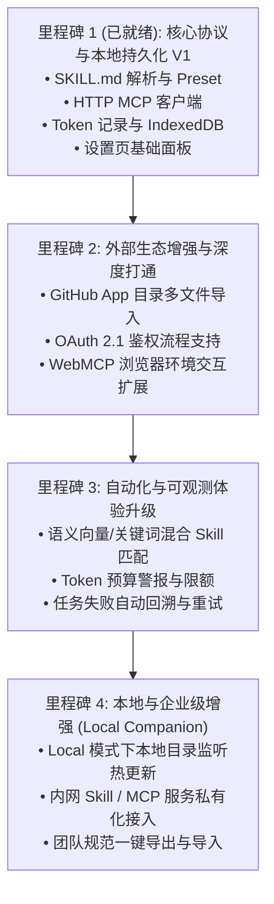

# Yggit Agent — Skill、MCP、Token 统计与服务可观测性 PRD

> 版本：V1.0  
> 类型：产品需求文档（PRD）  
> 状态：方案定稿，分阶段实施推进  
> 所属模块：Git Agent 智能扩展 / 开放协议连接 / 计量与可观测性 / 双模统一驱动

---

## 1. 需求背景与核心价值

### 1.1 现状与痛点

现有的 Yggit Agent 具备基础的 Git 上下文理解和会话交互能力，但在实际工程与深度 Git 协作场景中，面临以下瓶颈：

1. **专业知识固化，无法复用团队工程规范**：
   - 不同的项目和团队有着截然不同的 Code Review 规范、Commit Message 格式标准（如 Conventional Commits、Angular 规范）以及冲突解决 SOP。
   - 痛点：目前 Agent 只能靠用户在每次 Prompt 里临时输入指令，缺乏持久化、团队级沉淀的**专业知识与流程扩展（Skill）**。
2. **缺乏连接外部生态的工具标准**：
   - Git 操作往往与外部系统紧密相关（如 GitHub/GitLab Issue、CI/CD 构建日志、代码分析 Lint 服务、内部脚手架）。
   - 痛点：Agent 缺乏标准的外部工具连接协议，无法安全、无侵入地调用用户已有的服务。
3. **Token 消耗缺乏透明度与成本控制**：
   - 随着 Agent 多轮对话、差异比对、上下文拼接等操作增加，用户无法感知消耗了多少 Token、哪些模型耗费多、Prompt Cache 是否生效。
   - 痛点：缺少类似 Calm Ops (`ticket-janitor`) 标准的 Token 利用率与调用日志仪表盘，成本难以评估。
4. **Agent 执行黑盒，排错与反馈成本高**：
   - Agent 执行工具或多步思考时，用户无法看清内部步骤（如匹配了什么 Skill、发起了什么 Tool Call、入参和结果是什么）。
   - 遇到异常时缺少结构化诊断日志，无法一键生成标准化 Issue 报告反馈问题。

### 1.2 核心目标：开放生态、工具扩展、透明可控

- **Skill 开放化**：遵循开放的 [Agent Skills](https://agentskills.io/) 标准（`SKILL.md` 格式），支持用户导入 Local 文件、GitHub 仓库或使用内置预设，按需渐进式加载到 Prompt。
- **MCP 协议标准化**：遵循官方 [Model Context Protocol (MCP)](https://modelcontextprotocol.io/) 规范，提供 Streamable HTTP Client 与 WebMCP（`navigator.modelContext`）嗅探桥接，用户可随时接入任意 HTTP MCP Server。
- **计量与可观测透明化**：记录每一次交互的 Prompt / Completion / Cached Tokens、时延与状态，提供 7d/30d/90d 维度 KPI、模型分布、用途分布与历史调用日志。
- **任务执行白盒化与诊断一键化**：记录任务分步执行流水线（Skill 匹配 ➔ LLM 生成 ➔ Tool 调用 ➔ 结果渲染），并提供五大模块集中日志流与一键复制脱敏 Issue 报告。
- **用户数据绝对本地化**：Edge 模式基于浏览器 IndexedDB，Local 模式基于本地存储，源码、Diff、Git 历史与 Token 记录**绝不上传任何云端官方服务器**。

---

## 2. 整体架构与设计原则

```text
                           Yggit Agent
                                |
                 +--------------+--------------+
                 |                             |
            Skill Engine                   MCP Client
                 |                             |
           Skill Registry              MCP Server Manager
                 |                             |
      +----------+----------+       +----------+----------+
      |          |          |       |          |          |
    Preset     Local      GitHub   HTTP Srv   WebMCP   OAuth/Bearer
      |          |          |       |          |          |
      +----------+----------+       +----------+----------+
                 |                             |
                 +--------------+--------------+
                                |
                         Agent Runtime
                                |
            +-------------------+-------------------+
            |                                       |
    Observability (Tokens)                  Diagnostics (Logs)
    IndexedDB / Aggregation                 Ring Buffer / Export
            |                                       |
            +-------------------+-------------------+
                                |
                        Settings Center UI
       (/settings/skills, mcp, tokens, tasks, logs)
```

### 2.1 核心设计原则

1. **协议标准化，避免厂商绑定**：
   - Skill 严格使用 `SKILL.md`（带 YAML Frontmatter），不发明私有规则文件。
   - MCP 严格遵循 JSON-RPC 2.0 与官方工具声明契约。
2. **环境双模统一 (Edge & Local)**：
   - Edge 纯浏览器环境下，全部数据保存在浏览器 IndexedDB，网络通过前端直接请求外部 MCP 或 GitHub。
   - Local 模式下无缝复用统一的数据模型与接口，并支持本地文件系统直接读写。
3. **渐进式按需加载 (Progressive Loading)**：
   - 初始只加载 Skill 元信息（名称与描述），经意图匹配器判定相关后再完整注入 `SKILL.md` 指南，杜绝上下文浪费。
4. **权限最小化与数据安全**：
   - 工具调用与配置凭据（Token）保存在用户设备本地，不经中间服务转发。
   - 敏感信息在日志导出提报时自动脱敏。

---

## 3. 详细需求规格

### 3.1 模块一：自定义 Skill 系统

| 需求编号   | 功能点                      | 详细描述                                                                                           | 优先级 |
| :--------- | :-------------------------- | :------------------------------------------------------------------------------------------------- | :----- |
| **SKL-01** | **Agent Skills 标准解析**   | 解析 `SKILL.md`，提取 YAML Frontmatter (`name`, `description`, `tags`) 及 Markdown 正文指令。      | P0     |
| **SKL-02** | **内置预设 Skill (Preset)** | 开箱预装 3 款高频技能：代码审查规范、冲突解决分析、规范化 Commit 编写。支持一键恢复与禁用。        | P0     |
| **SKL-03** | **Local Skill 导入**        | 支持手动粘贴/输入 `SKILL.md` 源码或通过本地文件导入，解析后保存至本地存储。                        | P0     |
| **SKL-04** | **GitHub Skill 挂载**       | 支持配置 GitHub 仓库（所有者、仓库名、分支、目录、可选 PAT），自动拉取 `SKILL.md` 并保持来源溯源。 | P1     |
| **SKL-05** | **渐进式意图匹配与注入**    | 根据用户当前对话与上下文自动匹配最相关的 Skill，将规范合并入 System Prompt 中引导模型。            | P0     |
| **SKL-06** | **Skill 设置中心管理 UI**   | 提供 `/settings/skills` 页面，支持卡片流展示、启停开关、删除、详情/源码预览及导入弹窗。            | P0     |

---

### 3.2 模块二：WebMCP & HTTP MCP 外部工具集成

| 需求编号   | 功能点                     | 详细描述                                                                                             | 优先级 |
| :--------- | :------------------------- | :--------------------------------------------------------------------------------------------------- | :----- |
| **MCP-01** | **JSON-RPC HTTP 客户端**   | 实现标准 Streamable HTTP 协议传输，支持 `initialize`、`tools/list`、`tools/call`、`resources/list`。 | P0     |
| **MCP-02** | **认证与安全传输**         | 支持 Bearer Token 认证头注入及匿名模式，密钥保存在本地 IndexedDB。                                   | P0     |
| **MCP-03** | **WebMCP 原生环境嗅探**    | 探测浏览器 `navigator.modelContext` / `window.modelContext`，实时展示当前浏览器环境的 MCP 支持状态。 | P1     |
| **MCP-04** | **工具动态注册与命名空间** | 将 MCP 工具格式转换为 Agent 工具规范，采用 `mcp__{serverId}__{toolName}` 统一命名空间防冲突。        | P0     |
| **MCP-05** | **动态路由与执行隔离**     | 在 Agent 工具执行分发层识别 `mcp__` 前缀，动态发起远程调用并向模型回传结果及异常处理。               | P0     |
| **MCP-06** | **MCP 设置中心管理 UI**    | 提供 `/settings/mcp` 页面，支持添加/编辑 Server、一键测试连接、工具清单展开与个别工具禁用开关。      | P0     |

---

### 3.3 模块三：Token 计量与可观测性看板

| 需求编号   | 功能点                    | 详细描述                                                                                                | 优先级 |
| :--------- | :------------------------ | :------------------------------------------------------------------------------------------------------ | :----- |
| **MET-01** | **全链路 Token 自动捕获** | 在 LLM 请求生命周期中统一拦截，支持流式 SSE (`include_usage`) 与非流式的 Token、时延、状态记录。        | P0     |
| **MET-02** | **本地时序持久化与聚合**  | 基于 IndexedDB 存储原始调用记录，提供 7d / 30d / 90d 滑动窗口聚合计算。                                 | P0     |
| **MET-03** | **核心指标仪表盘**        | 展示总消耗 Token、Prompt Tokens、Completion Tokens、Cached Tokens（及缓存命中率）、调用频次、平均时延。 | P0     |
| **MET-04** | **多维分布统计**          | 按 Model 模型维度和 Purpose 业务用途（`chat` / `diagnostic` / `git_action` / `task`）生成分布比例。     | P0     |
| **MET-05** | **最近调用日志列表**      | 呈现最近 20~100 次调用的时间戳、模型、用途、状态、耗时与各类 Token 明细。                               | P0     |
| **MET-06** | **Token 看板 UI**         | 提供 `/settings/tokens` 页面，遵循 Calm Ops / ticket-janitor 视觉规范设计。                             | P0     |

---

### 3.4 模块四：Agent Task 任务全流程追溯

| 需求编号   | 功能点                 | 详细描述                                                                                            | 优先级 |
| :--------- | :--------------------- | :-------------------------------------------------------------------------------------------------- | :----- |
| **TSK-01** | **任务实体生命周期**   | 会话触发复杂任务时创建 `AgentTask` 实体，状态流转：`pending` ➔ `running` ➔ `completed` / `failed`。 | P0     |
| **TSK-02** | **分步执行流水线追踪** | 细粒度记录 `AgentTaskStep`：Skill 意图匹配 ➔ LLM 回合 ➔ Tool 工具调用（入参/返回值） ➔ 结果渲染。   | P0     |
| **TSK-03** | **任务管理与追溯 UI**  | 提供 `/settings/tasks` 页面，支持任务列表、状态筛选、耗时汇总、关联 Token 汇总与时间轴展开详情。    | P0     |

---

### 3.5 模块五：服务诊断日志与一键 Issue 提报

| 需求编号   | 功能点                      | 详细描述                                                                                            | 优先级 |
| :--------- | :-------------------------- | :-------------------------------------------------------------------------------------------------- | :----- |
| **LOG-01** | **多模块统一日志记录**      | 覆盖 `agent`、`mcp`、`skill`、`git`、`system` 五大模块，支持 Debug/Info/Warn/Error 分级与双层缓冲。 | P0     |
| **LOG-02** | **实时交互式日志流查看**    | 提供 `/settings/logs` 页面，支持按日志级别快速过滤、按模块过滤以及关键词实时检索。                  | P0     |
| **LOG-03** | **一键生成脱敏 Issue 报告** | 提供「Copy for Issue」按钮，抓取最近环境信息与告警错误，自动剔除 Token/密钥生成标准 Markdown。      | P0     |

---

## 4. 任务拆解与交付路线图（分阶段任务设计）

建议将该能力拆解为 **4 个里程碑阶段（Milestones / Tasks）**：



### 里程碑 1：核心协议、全功能数据流与设置中心（当前状态：已完成 V1 闭环）

- **范围**：Skill 解析、内置 Preset、IndexedDB 存储、Prompt 动态注入；HTTP MCP JSON-RPC 客户端、动态工具路由；Token 流式拦截与看板；Task 流水线；服务日志与 Issue 导出。
- **交付物**：41 个代码文件、4 个设置页路由、4 组单元测试全绿。

### 里程碑 2：外部生态深化与安全认证增强（下一步规划）

- **范围**：
  - GitHub 仓库递归扫描多级目录下的所有 `SKILL.md`（支持 `agent-skills/` 树结构）。
  - MCP 服务器支持标准 OAuth 2.1 授权码流（带有 PKCE），免去手动粘贴 Token。
  - WebMCP 标准提案的更深层 API 绑定。

### 里程碑 3：可观测与自动化策略优化

- **范围**：
  - Token 使用阈值预警（如当今日消耗达到设定预算时提示或阻断）。
  - Skill 匹配度评分优化（从关键词权重升级为多重上下文启发式匹配）。
  - Task 失败自动诊断与建议重试步骤。

### 里程碑 4：Local 伴侣模式原生互联

- **范围**：
  - 在 Local 伴侣模式下直接监听用户指定的本地目录变更（`chokidar`），修改本地 `SKILL.md` 无需手动重新导入即可热生效。
  - 支持团队内网私有 Skill Registry 地址导入。

---

## 5. 验收标准与非功能性要求

1. **零数据外流（隐私合规）**：
   - 任何 Skill 内容、Git 代码片段、Token 消耗记录、MCP 调用参数严禁发往 Yggit 或第三方非授权服务器。
2. **UI 规范一致性**：
   - 界面严格遵循 Calm Ops 设计规范，严格使用 `react-icons`，禁用非标准 Emoji 图标。
   - 所有用户界面文案必须通过 `lib/i18n` 具备简中、繁中、英文多语言支持。
3. **高可靠性与错误降级**：
   - 任意单个 MCP Server 连接失败或超时（默认 10s 超时），绝不可导致 Agent 整体会话崩溃，应优雅降级为工具错误回传。
   - Skill 解析失败时跳过该项并记录错误日志，不阻断主流程。
