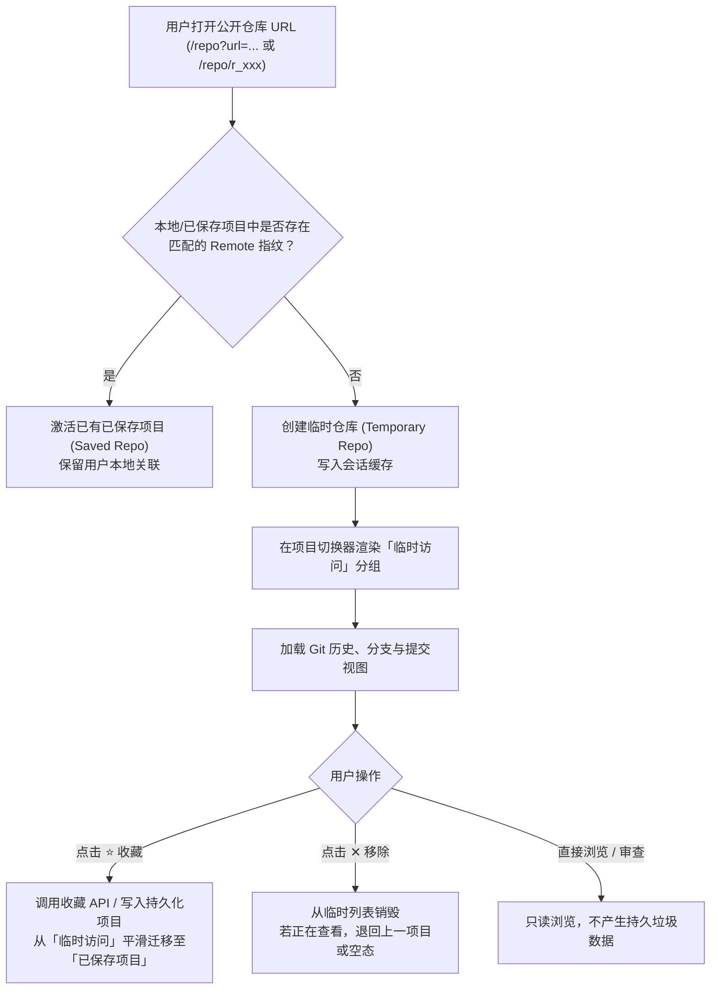

# Yggit — 临时仓库访问与收藏管理 PRD (Product Requirements Document)

> 版本：V1.0  
> 日期：2026-11-15  
> 状态：方案已审阅，进入技术实现  
> 所属模块：项目切换器 (Project Switcher) / 仓库身份路由 (Repository Identity & URL Routing) / 收藏管理 (Favorites)

---

## 1. 需求背景与目标

### 1.1 背景
Yggit 是一款面向开发者的高性能 Git 历史可视化与分支演变探索工作台。
在实际开发与协作中，用户经常需要通过 URL 快速分享某条 Commit、分支演变、代码 Diff 或特定文件位置。
在传统的 Git 工具或本地桌面应用中，接收方打开一个分享链接时往往面临以下摩擦：
1. **必须先克隆或手动导入**：若接收方本地尚未克隆对应仓库，无法直接打开链接浏览。
2. **列表污染**：用户仅因一次临时 Review 或排查问题打开的公开仓库，若被迫永久加入个人项目目录，会导致项目列表充斥无用条目。
3. **缺少会话级缓冲**：用户在临时浏览过程中，若切换至其他项目，容易丢失刚查看的临时仓库上下文。

### 1.2 核心理念
**「打开即看，收藏才保存」 (Browse First, Star to Save)**

- **打开即看**：对于 GitHub、GitLab 等公开仓库或已分享的远程仓库，用户点击 URL 即可直接在当前浏览器/应用会话中渲染 Git Graph、浏览 Commit、查看变更，无需预先 Git Clone。
- **收藏才保存**：临时仓库仅保存在当前会话状态（Session-scoped）中，显式归入项目切换器的「临时访问 (Temporary)」分组；只有用户主动点击「收藏 (⭐)」时，才将其转为持久化的已保存项目（Saved Repository）。

---

## 2. 目标与非目标

### 2.1 核心目标 (P0)
1. **URL 直接访问公开仓库**：
   - 支持通过 URL 参数（如 `/repo?url=https://github.com/owner/repo` 或标准化的 `/repo/github/owner/repo`）直接打开公开仓库。
2. **智能身份关联 (Smart Identity Matching)**：
   - 用户打开公开链接时，系统优先比对用户本地与已有项目库中的规范化 Remote 指纹。
   - 若匹配到已保存项目，则无缝定位至已有本地项目，避免重复创建。
3. **临时访问模式 (Temporary Access Mode)**：
   - 若未匹配到已有项目，自动实例化为 Temporary Repository。
   - 临时仓库不写入持久化数据文件（`catalog.json` / IndexedDB），刷新页面或在会话内保留，关闭会话后可自动清理。
4. **项目切换器集成**：
   - 项目切换器（Project Switcher）新增独立分组「临时访问 (Temporary)」。
   - 临时条目展示明显的临时标识、一键收藏 (⭐) 按钮和移除 (✕) 按钮。
5. **一键收藏与状态流转**：
   - 点击收藏后，无缝将该项目迁移至「已保存项目」，持久化到项目库。
   - 点击移除后，从临时列表中剔除；若当前正处于该仓库，自动回退到默认项目或空态。

### 2.2 延伸目标 (P1)
- 支持私有仓库的个人访问令牌 (PAT) 认证。
- 临时仓库的本地克隆快捷引导（"一键克隆至本地"）。
- 批量清理所有临时仓库。

### 2.3 非目标
- 本期不涉及跨用户云端同步账号体系。
- 不强制在用户本地文件系统自动下载数 GB 的完整 Git 目录。
- 不提供对临时远程仓库的写操作（如 Push、Commit、Cherry-pick 等，仅支持只读浏览与审查）。

---

## 3. 核心概念与数据模型

### 3.1 实体区分

| 维度 | 临时仓库 (Temporary Repository) | 已保存仓库 (Saved Repository) |
|---|---|---|
| **产生方式** | 打开分享链接、URL 直达、切换器粘贴 URL | 用户主动「添加本地目录」、「从远程克隆」、或在临时模式下「点击收藏」 |
| **存储介质** | 内存状态 (In-Memory) + `sessionStorage` 备份 | 本地数据文件 (`data/git-projects/catalog.json`) / IndexedDB |
| **项目切换器位置** | 「临时访问」独立折叠组，置顶或紧贴根列表 | 根项目列表或用户自定义文件夹 (Folders) |
| **生命周期** | 当前浏览器会话，支持手动移除 (✕) | 长期持久化，关闭应用或重启后依然存在 |
| **支持能力** | 只读浏览 Git Graph、Commit 日志、Diff、代码树 | 完整读写能力（本地仓库）或持久收藏视图 |
| **操作行为** | ⭐ 收藏（转为 Saved）、✕ 移除（销毁） | 重命名、移动至文件夹、删除项目记录 |

### 3.2 仓库身份与指纹定义
- **Remote Fingerprint**：统一规范化的远程仓库指纹，去除 protocol、auth、尾部 `.git` 及大小写差异。
  - 例：`https://github.com/DavidKk/yggit.git` 与 `git@github.com:DavidKk/yggit.git` 均规范化为 `github.com/davidkk/yggit`。
- **Repo Key**：
  - 本地离线项目：`l_<uuid>` 或本地绝对路径摘要。
  - 远程共享项目：`r_<fingerprint_hash>` 或 `github/{owner}/{repo}`。

---

## 4. 详细用户交互与体验设计

### 4.1 流程图：URL 访问与状态分流

### 4.2 项目切换器 (Project Switcher) UI 规范

1. **输入框交互**：
   - 切换器顶部的搜索框支持直接粘贴 Git Remote URL（如 `https://github.com/owner/repo`）。
   - 若检测到输入为 Git URL 且项目中不存在，下拉框首项显示「以临时模式打开公开仓库 ↵」，按下回车即可立即载入临时仓库。
2. **分组展示**：
   - 在项目目录的「文件夹」和「项目列表」下方（或上方醒目位置），展示「临时访问 (Temporary)」组。
   - 条目样式：带有淡紫色/青色 `[临时]` Badge 标识，右侧常驻或 Hover 显示两个轻量图标按钮：
     - **⭐ 收藏**：Tooltip 提示「收藏到项目列表」；点击后图标变为实心星标，条目以平滑动画移入已保存项目列表。
     - **✕ 移除**：Tooltip 提示「从临时列表移除」；点击后移除。
3. **空态快速入口**：
   - 当没有选择任何项目时，主界面的 EmptyState 提供直观的「打开本地仓库」与「打开项目选择器」操作，杜绝死锁空态。

---

## 5. 异常处理与边界场景

1. **网络超时或 API Rate Limit**：
   - 若通过 Remote API 加载公开仓库遇到 GitHub 60次/小时未认证限制，弹出友好的凭据设置提示（支持输入只读 Personal Access Token）或本地克隆建议。
2. **重复收藏**：
   - 若用户尝试收藏一个指纹已存在的临时项目，前端自动合并到已有项目，并触发轻量通知（`Toast: "该仓库已在项目列表中"`）。
3. **会话恢复**：
   - 用户在浏览临时项目时按下 F5 刷新页面，通过 `sessionStorage` 与 URL 中的 `repoKey` 保持临时仓库状态不丢失。
