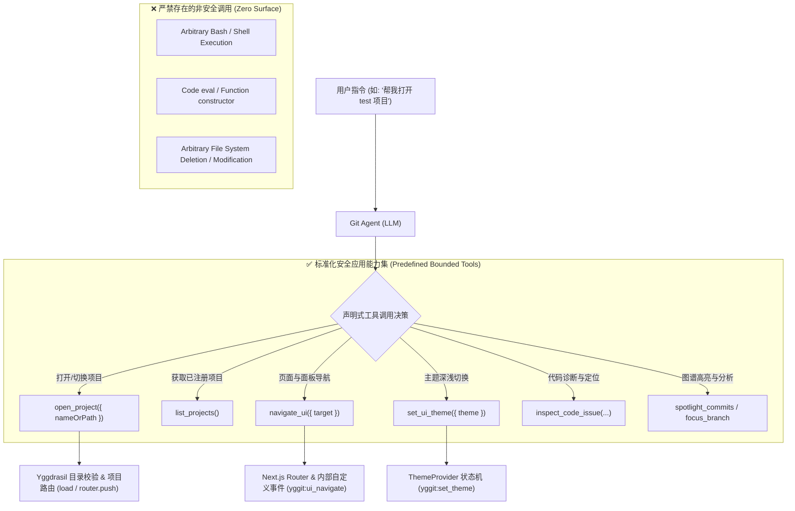

# Agent Application Control & Security Architecture

> [!IMPORTANT]
> **Core Principle**: The Agent must be capable of controlling application features (opening projects, switching views, opening settings, toggling appearance, and diagnostic highlighting). However, in Local (and Edge) modes, the Agent **must never** execute arbitrary system-level shell commands, arbitrary scripts, or unbounded `eval`. All capabilities must be standardized (规范), strictly bounded, and backed by concrete TypeScript application logic and structured Tool Calling definitions.

---

## 1. Architectural Model & Threat Surface Elimination

---

## 2. Standardized Application Control Tools

### 2.1 `open_project`

- **Purpose**: Open or switch to a registered repository/project in Yggdrasil by name, folder path, or ID.
- **Safety Boundary**: Looks up entries within Yggdrasil's project catalog (`getCatalogProjects()`). Never runs arbitrary path execution; validates that the project is registered, determines its safe application URL (`/git/l_${id}`), and smoothly calls the application's internal loader `load(target)` and `router.push`.
- **Parameters**:
  - `nameOrPath` (`string`, required): Name, path, or ID of the registered project.

### 2.2 `list_projects`

- **Purpose**: List registered repositories in Yggdrasil, showing their names, paths, groups, and local/remote status.
- **Safety Boundary**: Read-only query against the local driver or Edge IndexedDB project store.
- **Parameters**: None.

### 2.3 `navigate_ui`

- **Purpose**: Open settings pages or UI panels when requested (e.g. "帮我打开设置", "打开冲突处理", "查看工作树").
- **Safety Boundary**: Restricted enum target list:
  - Settings: `settings_models`, `settings_privacy`, `settings_general`, `settings_menus`
  - Panels: `panel_commit`, `panel_conflicts`, `panel_worktree`, `panel_branches`, `panel_stash`, `panel_tags`, `git_home`.
- **Implementation**: Handled via client router and `yggit:ui_navigate` event dispatcher.

### 2.4 `set_ui_theme`

- **Purpose**: Switch application appearance between `auto` (system), `light`, and `dark`.
- **Safety Boundary**: Strictly typed enum: `['auto', 'light', 'dark']`. Updates persisted preference via `writeStoredTheme` and dispatches `yggit:set_theme` to `ThemeProvider`.

---

## 3. Strict Boundary & Safe Execution Rules in System Prompt

The embedded `AGENT_SYSTEM_PROMPT` enforces:

1. **Never refuse application operations**: The agent is explicitly equipped with `open_project`, `navigate_ui`, `set_ui_theme`, etc., and must never claim it lacks UI or application control capabilities.
2. **Never execute arbitrary shell / eval**: All interactions are limited strictly to the predefined tool calls in `AGENT_GIT_TOOLS`.
