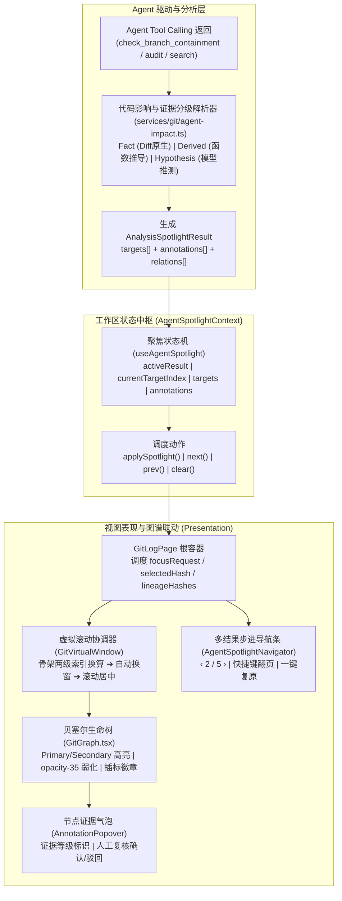

# Yggit Agent — Git 图谱定位、节点标记与代码影响技术设计

> 版本：V1.0  
> 状态：方案设计完成，待编码实施  
> 核心模块：`components/git/agent/spotlight/*`, `components/git/GitGraph.tsx`, `components/git/GitLogPage.tsx`, `services/git/agent-impact.ts`  
> 架构归属：Yggit Agent 体系 — 子需求二（图谱定位与标记技术架构）

---

## 1. 架构目标与总体数据拓扑

本子需求构建一套由 Agent 驱动的 **Git 图谱精确定位、多节点高亮弱化、节点插标 (Annotation) 与多结果步进导航系统**。

该系统深度结合 Yggdrasil 现有的 **两级虚拟滑动窗口（2-tier Virtual Window Graph）** 和 **有机贝塞尔生命树渲染管线（SVG Bézier DAG）**，将 Agent 的分析产出无缝转化为视图渲染指令。

### 1.1 总体架构与数据流向



---

## 2. 核心数据结构与契约定义 (`lib/agent/spotlight-types.ts`)

```typescript
/** 证据确凿等级定义 */
export type EvidenceLevel = 'fact' | 'derived' | 'hypothesis'

/** 标记语义类型 */
export type AnnotationType = 'risk' | 'audit' | 'info' | 'relation'

/** 目标节点在本次分析中的角色 */
export type TargetRole = 'primary' | 'related' | 'candidate'

/** 绑定在 Git 节点上的结构化标记 */
export interface GraphAnnotation {
  id: string
  repoKey: string
  commitHash: string
  type: AnnotationType
  title: string
  summary: string
  evidenceLevel: EvidenceLevel
  evidenceFiles?: Array<{
    path: string
    lines?: string
    snippet?: string
  }>
  status: 'pending' | 'confirmed' | 'dismissed'
  createdAt: number
}

/** 聚焦目标定义 */
export interface CommitTarget {
  hash: string
  role: TargetRole
  label?: string
  reason?: string
}

/** 非拓扑语义关系关联 */
export interface CommitRelation {
  sourceHash: string
  targetHash: string
  type: 'fixes' | 'reverts' | 'cherry-picked' | 'depends-on'
  evidence?: string
}

/** 一次完整的图谱定位分析结果 */
export interface AnalysisSpotlightResult {
  analysisId: string
  title: string
  summary: string
  targets: CommitTarget[]
  annotations: GraphAnnotation[]
  relations?: CommitRelation[]
}
```

---

## 3. 图谱着色与弱化渲染管线 (`GitGraph.tsx`)

### 3.1 分级高亮与不透明度控制 (Color & Opacity Pipeline)

在 [`components/git/GitGraph.tsx`](file:///Users/davidjones/Develop/ops/apps/yggdrasil/components/git/GitGraph.tsx) 中，扩展现有 `lineageHashes` 机制，增加对角色（Role）的细分：

```typescript
// 1. 节点与轮廓渲染
const targetMeta = spotlightTargetsMap.get(commit.hash)
const isPrimary = targetMeta?.role === 'primary'
const isRelated = targetMeta?.role === 'related' || isLineageHit
const isCandidate = targetMeta?.role === 'candidate'

// 节点视觉反馈
const nodeClassName = cn(
  'transition-all duration-150',
  isPrimary && 'ring-2 ring-accent ring-offset-2 ring-offset-[var(--panel)] scale-125 z-20 shadow-[0_0_12px_var(--accent)]',
  isRelated && !isPrimary && 'ring-1.5 ring-accent/80 ring-offset-1 scale-110 z-10 shadow-[0_0_6px_var(--accent)]',
  isCandidate && 'ring-1.5 ring-amber-500 scale-105 z-10'
)

// 2. 背景分支与非目标节点弱化 (Dimming)
const isDimmed = isSpotlightActive && !targetMeta && !isLineageHit && !isHead
const rowOpacityClass = isDimmed ? 'opacity-35 hover:opacity-100' : 'opacity-100'

// 3. SVG 贝塞尔连线粗细与不透明度调整
const strokeOpacity = isSpotlightActive ? (isTargetStroke ? 1.0 : 0.25) : 1.0
const strokeWidth = isTargetStroke ? (isTrunk ? 3.5 : 2.8) : 1.8
```

---

## 4. 虚拟滑动窗口（Virtual Window）跨区间定位算法

当 Agent 请求定位的 Commit 远离当前视口（可能位于几百个提交之前，尚未载入当前的 200-commit 滑动窗口）时，系统通过 **两级骨架索引（Skeleton Index）** 换算并精准触发窗口滑动：

```typescript
export function resolveVirtualWindowOffset(options: {
  targetHash: string
  skeletonIndex: Array<{ hash: string; index: number }>
  windowSize: number
  rowHeight: number
}): { targetWindowStart: number; scrollOffset: number } | null {
  const item = options.skeletonIndex.find((entry) => entry.hash === options.targetHash)
  if (!item) return null

  const targetRow = item.index
  // 保持目标节点居中在滑动窗口视野的中央 (预留前置 50 个节点缓冲区)
  const targetWindowStart = Math.max(0, targetRow - Math.floor(options.windowSize / 3))
  const scrollOffset = targetRow * options.rowHeight

  return { targetWindowStart, scrollOffset }
}
```

- **防夺焦判定 (Anti-Stealing Guard)**：
  - 内部维护 `isManualScrolling: boolean`；
  - 仅在 Agent 首次返回结果或用户显式点击 Stepper（`‹ ›`）时下发 `focusRequest`；
  - 一旦监听到底层滚轮事件（Wheel Event）或用户拖动滚动条，立刻锁死自动化滚动，防止干扰人工阅读。

---

## 5. Agent 节点插标与证据卡片系统

### 5.1 徽标组件 (`components/git/agent/spotlight/AnnotationBadge.tsx`)

在 Commit 列表的 RefCell 旁预留极小尺寸的插标槽位：

```tsx
export function AnnotationBadge({ annotations, onClick }: { annotations: GraphAnnotation[]; onClick: (e: React.MouseEvent) => void }) {
  if (!annotations || annotations.length === 0) return null
  const primary = annotations[0]
  const count = annotations.length

  const iconMap = {
    risk: <LuAlertTriangle className="size-3 text-red-400 animate-pulse" />,
    audit: <LuSearch className="size-3 text-amber-400" />,
    info: <LuInfo className="size-3 text-sky-400" />,
    relation: <LuLink className="size-3 text-emerald-400" />,
  }

  return (
    <button
      type="button"
      onClick={onClick}
      className="inline-flex items-center gap-0.5 px-1 py-0.5 rounded bg-[var(--panel)]/80 border border-border/80 hover:border-accent text-[10px] font-sans transition-all duration-150 cursor-pointer"
      title={`${primary.title} (${annotations.length} 个标记)`}
    >
      {iconMap[primary.type]}
      {count > 1 ? <span className="font-mono text-[9px]">+{count - 1}</span> : null}
    </button>
  )
}
```

### 5.2 证据卡片 Popover (`AnnotationPopover.tsx`)

点击徽章展示轻量卡片：

1. **Header**：展示标记类型徽章 + 标题 + 证据等级（`[Fact] / [Derived] / [Hypothesis]`）；
2. **Body**：展示 2~3 行摘要说明，附带变更文件与行号超链接（点击直接打开右侧 Diff）；
3. **Actions**：人工确认按钮 `[ ✓ 标记确认 ]` 与 `[ ✕ 驳回推断 ]`，操作结果实时更新当前标记状态。

---

## 6. 多结果步进导航器 (`AgentSpotlightNavigator.tsx`)

当分析结果包含多个候选 Commit（例如“检测到 5 个可疑合入点”）时，在页面底部小药丸右侧或主视口右上角浮现微型导航胶囊：

```text
╭─────────────────────────────────────────────────────────────╮
│ 🔍 发现 5 个异常合入节点   ‹  2 / 5  ›   [7a88b1]   ✕ 恢复全景 │
╰─────────────────────────────────────────────────────────────╯
```

### 交互实现逻辑

- **快捷键绑定**：
  - `ArrowLeft` / `p`：跳转上一个目标；
  - `ArrowRight` / `n`：跳转下一个目标；
  - `Escape`：调用 `clearSpotlight()`，瞬间恢复图谱全景。
- **状态迁移**：
  - 切换索引时：自动同步 `setSelectedHash(targets[nextIndex].hash)` 与 `setFocusRequest({ hash: ... })`。

---

## 7. 代码影响与证据等级解析服务 (`services/git/agent-impact.ts`)

为了严格落地 PRD 要求的 **三级证据链（Fact / Derived / Hypothesis）**，后端/本地 Driver 封装如下结构化解析器：

```typescript
export async function resolveCommitImpact(
  driver: IGitDriver,
  repo: string,
  commitHash: string
): Promise<{
  factEvidence: { files: string[]; isMerge: boolean; parents: string[]; insertions: number; deletions: number }
  derivedEvidence: { modifiedFunctions: string[] }
}> {
  // 1. Git 原生确凿事实 (Fact)
  const diff = await driver.readCommitDiff({ repo, hash: commitHash })
  const factEvidence = {
    files: diff.changes.map((c) => c.path),
    isMerge: (diff.commit.parents?.length ?? 0) > 1,
    parents: diff.commit.parents || [],
    insertions: diff.changes.reduce((sum, c) => sum + (c.insertions || 0), 0),
    deletions: diff.changes.reduce((sum, c) => sum + (c.deletions || 0), 0),
  }

  // 2. 基于统一 Diff Header 提取函数级变更 (Derived)
  const modifiedFunctions: string[] = []
  const functionRegex = /@@\s+-[0-9,]+\s+\+[0-9,]+\s+@@\s*([a-zA-Z0-9_$]+(?:\(.*\))?)/g
  for (const file of diff.changes) {
    if (!file.patch) continue
    let match: RegExpExecArray | null
    while ((match = functionRegex.exec(file.patch)) !== null) {
      if (match[1]) modifiedFunctions.push(match[1].trim())
    }
  }

  return {
    factEvidence,
    derivedEvidence: { modifiedFunctions: [...new Set(modifiedFunctions)] },
  }
}
```

---

## 8. 无状态深链接序列化扩展 (`lib/git/share-card.ts`)

将多节点高亮与标记序列化至 URL Query 参数中，接收方无需登录和数据库查询即可 100% 还原排查视口：

```
/repo/[...slug]?focus=7a88b1&lineage=7a88b1,c128f9,f092e4&targets=7a88b1:primary,c128f9:related,f092e4:candidate&reason=risk:test_leak&desc=feat_contains_test
```

- **`focus`**：主聚焦的目标 Commit Hash（打开时居中高亮并选中）；
- **`lineage`**：逗号分隔的高亮链路提交集合（用于图谱快速连线加粗与弱化其余分支）；
- **`targets`**：细粒度角色映射（`primary`、`related`、`candidate`），对应不同发光光晕；
- **`reason`**：标记类型与原因标识（如 `risk:test_leak`）；
- **`desc`**：诊断摘要描述（URI 编码）；
- 页面挂载时通过 `useMemo` 解析该 URL，一键恢复 `targets`、`lineageHashes` 与弱化视觉，做到**“链接即诊断现场”**。

---

## 9. 模块拆分与目录清单

```
components/git/agent/
└── spotlight/
    ├── AgentSpotlightNavigator.tsx  # 悬浮多结果步进控制器 (‹ 2 / 5 ›)
    ├── AnnotationBadge.tsx          # 节点行轻量图标插槽
    ├── AnnotationPopover.tsx        # 证据卡片详情弹出层
    └── RelationLineOverlay.tsx      # 非拓扑逻辑关联视觉层 (虚线连接)

lib/agent/
├── spotlight-types.ts               # 标记、目标、证据级别类型规范
└── spotlight-context.tsx            # 纯内存聚焦状态机 (useAgentSpotlight)

services/git/
└── agent-impact.ts                  # 代码影响与证据等级 (Fact/Derived) 提取器
```
