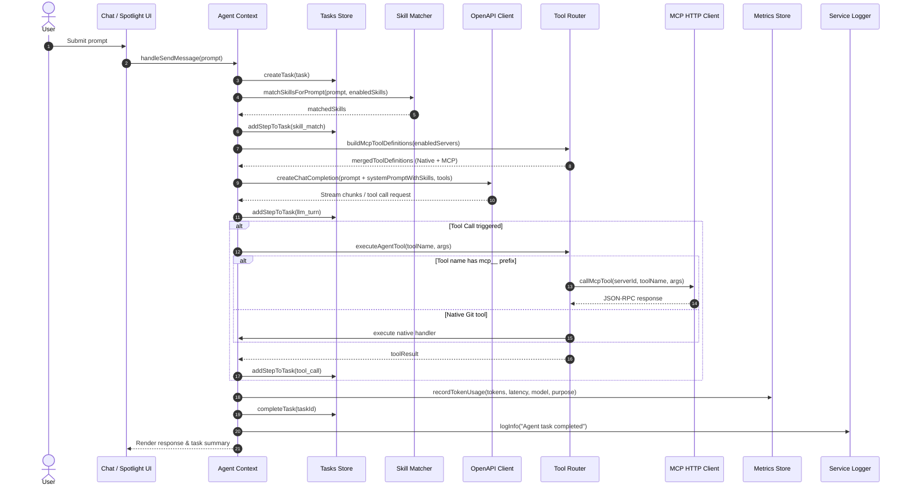

# Agent Skills, WebMCP, Token Observability & Service Diagnostics

This document outlines the architecture, data models, and runtime flows for the custom Skill engine, WebMCP & HTTP MCP tool integration, token usage observability, and service diagnostics in Yggdrasil.

## 1. Custom Skill System (Agent Skills Standard)

The Skill system adheres to the open standard defined by [Agent Skills](https://agentskills.io/) using `SKILL.md` as the core format with YAML frontmatter.

### Core Components

- **`lib/skills/types.ts`**: Types for `SkillDescriptor` and `ParsedSkillMd`.
- **`lib/skills/parser.ts`**: Extracts YAML frontmatter (`name`, `description`, metadata) and instructions body from `SKILL.md`.
- **`lib/skills/presets.ts`**: Out-of-the-box built-in skills (`Git Code Review`, `Git Conflict Analysis`, `Conventional Commits Crafting`).
- **`lib/skills/storage.ts`**: IndexedDB storage (`yggit_skills_store`) with preset initialization and live subscriptions.
- **`lib/skills/matcher.ts`**: Matches enabled skills dynamically against user requests and injects task workflows into the system prompt.
- **`lib/skills/providers/github-provider.ts`**: Fetches `SKILL.md` directly from public or private GitHub repositories.

---

## 2. Model Context Protocol (MCP) & WebMCP

Connects external tools and in-page capabilities to the Git Agent following the [Model Context Protocol](https://modelcontextprotocol.io/) specification.

### Core Components

- **`lib/mcp/types.ts`**: Types for `McpServerConfig`, `McpToolInfo`, and `WebMcpSupportReport`.
- **`lib/mcp/client.ts`**: Streamable HTTP client executing standard JSON-RPC 2.0 requests (`initialize`, `tools/list`, `tools/call`, `resources/list`, `prompts/list`).
- **`lib/mcp/webmcp.ts`**: Browser WebMCP (`document.modelContext`) environment probe.
- **`lib/mcp/storage.ts`**: Persistent configuration store for MCP servers in IndexedDB (`yggit_mcp_store`).
- **`lib/agent/tools.ts`**: Dynamic tool binding that maps enabled MCP server tools to `AgentToolDefinition`s (`mcp__{serverId}__{toolName}`) and routes executions seamlessly.

---

## 3. Token Metrics & Observability

Observability subsystem inspired by ticket-janitor, tracking input prompt tokens, output completion tokens, cached context hits, total volume, request counts, and latency.

### Core Components

- **`lib/agent/metrics/types.ts`**: `TokenUsageRecord` and `TokenMetricsSummary`.
- **`lib/agent/metrics/storage.ts`**: IndexedDB store (`yggit_metrics_store`), period aggregations (7d / 30d / 90d), cache hit rate calculations, model breakdowns, and purpose breakdowns.
- **`lib/agent/openapi-client.ts`**: Automatic token recording upon completion of each LLM turn (both streaming SSE and JSON).

---

## 4. Agent Task Tracking & Step Traces

Records the end-to-end execution journey of the Agent when tasked during user conversations.

### Core Components

- **`lib/agent/tasks/types.ts`**: `AgentTask` and `AgentTaskStep` (`skill_match`, `llm_turn`, `tool_call`, `artifact`).
- **`lib/agent/tasks/storage.ts`**: IndexedDB store (`yggit_tasks_store`) tracking task lifecycle (`pending`, `running`, `completed`, `failed`).
- **`lib/agent/agent-context.tsx`**: Automatic task instantiation, skill matching step tracing, tool call logging with arguments/results, and completion summaries.

---

## 5. Service Diagnostics Logs & Issue Reporting

Centralized in-memory ring-buffer and IndexedDB logging across `agent`, `mcp`, `skill`, `git`, and `system` modules.

### Core Components

- **`lib/logger/index.ts`**: `recordLog`, `logInfo`, `logWarn`, `logError`, `loadPersistedLogs`, and `generateIssueReportMarkdown`.
- **`components/git/agent/settings/LogsSettingsSection.tsx`**: Live log viewer, level/module filters, search, and one-click sanitized GitHub/GitLab issue report generator.

---

## 6. UI Settings Routes

Integrated into Yggdrasil's settings layout:

- `/settings/skills`: Custom Skills management.
- `/settings/mcp`: MCP servers & WebMCP status.
- `/settings/tokens`: Token utilization metrics and recent logs.
- `/settings/tasks`: Agent task execution trace viewer.
- `/settings/logs`: Service diagnostics logs and issue export.

---

## 7. System Execution Flow

The following sequence diagram illustrates the lifecycle of a prompt through Skill matching, dynamic MCP tool augmentation, execution tracing, and token recording:

---

## 8. Phased Task Breakdown & Delivery Milestones

To ensure high maintainability, verifiable safety, and decoupled iterative releases, the engineering implementation is structured into 4 distinct phases:

### Phase 1: Core Protocols & Persistent Foundations (Delivered)

- **Task 1.1: Skill Standard Engine**: `SKILL.md` parser, frontmatter reader, presets (`Git Code Review`, `Git Conflict Analysis`, `Conventional Commits Crafting`), and IndexedDB persistence.
- **Task 1.2: MCP HTTP Client**: JSON-RPC 2.0 client over Streamable HTTP, server configuration store, and dynamic tool name spacing (`mcp__{serverId}__{toolName}`).
- **Task 1.3: Observability & Task Tracing**: Stream SSE usage capture, period token aggregations (7d/30d/90d), task execution step traces, and diagnostics ring buffer logger.
- **Task 1.4: Calm Ops Settings UI**: Complete `/settings/{skills,mcp,tokens,tasks,logs}` panels with search, filters, modals, and one-click GitHub/GitLab issue report generator.

### Phase 2: Remote Ecology & Enhanced Authentication (Next Milestone)

- **Task 2.1: GitHub Multi-Skill Tree Walker**: Deep recursive fetcher supporting standard `agent-skills/` directory layouts in both public and private repositories.
- **Task 2.2: OAuth 2.1 with PKCE for MCP**: Standard browser OAuth authorization code grant flow without requiring manual token copy-pasting.
- **Task 2.3: Browser WebMCP API Full Binding**: Deep adapter for Chrome 146+ `window.modelContext` dynamic tool and prompt registration.

### Phase 3: Observability Policies & Heuristic Routing

- **Task 3.1: Token Budget Guard**: Configurable daily/monthly token limits with proactive UI warnings and pause controls.
- **Task 3.2: Context-Aware Skill Scoring**: Multi-signal scoring combining commit diff semantics, current branch state, and prompt intent.
- **Task 3.3: Self-Healing Task Retry**: Diagnostic engine proposing automated remediation steps on tool failures.

### Phase 4: Local Companion Integration

- **Task 4.1: File Watcher Hot-Reload**: Direct folder watching (`chokidar`) in Local Companion mode for instant hot reload of local `SKILL.md` changes.
- **Task 4.2: Private Registry & Air-Gapped Sync**: Offline bundle export/import for strictly air-gapped enterprise environments.

---

## 9. Security & Privacy Guarantees

1. **Zero External Data Leakage**: Skill content, source code fragments, commit messages, and token usage records remain strictly within the client device (browser IndexedDB or local companion storage). No telemetry or user content is transmitted to Yggit servers.
2. **Dynamic Tool Namespace Isolation**: All external MCP tools are bound to `mcp__{serverId}__{toolName}` prefixes, preventing accidental or malicious overriding of native Git system tools.
3. **Issue Report Sanitization**: Diagnostics export runs through token and secret redaction rules before rendering Markdown for external bug reports.
