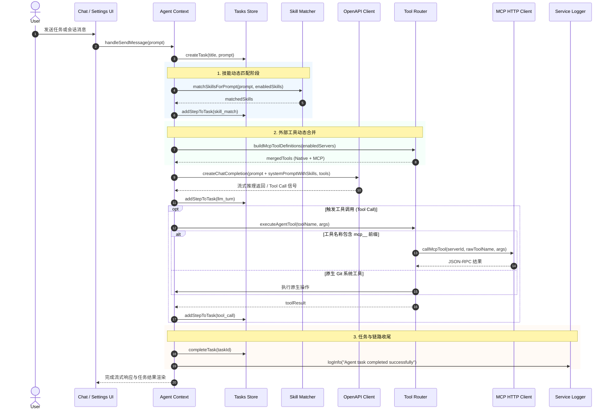

# Yggit Agent — Skill、MCP、任务流追踪与服务诊断技术架构文档

> 版本：V1.1  
> 类型：技术架构与系统设计规范（Technical Specification）  
> 状态：方案定稿，已完成 V1 核心闭环（Token 统计部分暂缓并移除，聚焦于 Skill、MCP、Tasks、Logs）  
> 关联 PRD：[docs/prd/agent-skills-mcp-and-observability.md](../prd/agent-skills-mcp-and-observability.md)  
> 目录索引：[docs/README.md](../README.md)

---

## 1. 架构总览与双模运行模型

Yggit Agent 采用**双模驱动架构（Dual-Mode Architecture）**，使同一套业务逻辑与数据模型能够无缝运行在 Edge（纯 Web 浏览器）与 Local（本地伴侣守护进程）两种形态下，实现技能、工具和任务追踪组件的来源无关与运行环境无关。

```text
                           +---------------------------+
                           |        Yggit Agent        |
                           +-------------+-------------+
                                         |
                  +----------------------+----------------------+
                  |                                             |
     +------------v------------+                   +------------v------------+
     |      Skill Engine       |                   |       MCP Client        |
     |  (lib/skills/matcher)   |                   |    (lib/mcp/client)     |
     +------------+------------+                   +------------+------------+
                  |                                             |
     +------------v------------+                   +------------v------------+
     |     Skill Registry      |                   |    MCP Server Manager   |
     |  (lib/skills/storage)   |                   |    (lib/mcp/storage)    |
     +------------+------------+                   +------------+------------+
                  |                                             |
      +-----------+-----------+                     +-----------+-----------+
      |           |           |                     |           |           |
+-----v-----+ +- -v- -+ +-----v-----+         +-----v-----+ +- -v- -+ +-----v-----+
|  Presets  | | Local | |  GitHub   |         | HTTP Srv  | |WebMCP | |OAuth/Auth |
+-----------+ +-------+ +-----------+         +-----------+ +-------+ +-----------+
                  |                                             |
                  +----------------------+----------------------+
                                         |
                           +-------------v-------------+
                           |       Agent Runtime       |
                           | (lib/agent/agent-context) |
                           +-------------+-------------+
                                         |
                  +----------------------+----------------------+
                  |                                             |
     +------------v------------+                   +------------v------------+
     |   Task Step Tracing     |                   |    Diagnostics (Logs)   |
     |    (lib/agent/tasks)    |                   |       (lib/logger)      |
     +------------+------------+                   +------------+------------+
                  |                                             |
                  +----------------------+----------------------+
                                         |
     +-----------------------------------v-----------------------------------+
     |                        Persistence Layer                              |
     |   EDGE: Browser IndexedDB (yggit_*_store)                             |
     |   LOCAL: Local Companion Storage / File System                        |
     +-----------------------------------------------------------------------+
```

### 1.1 双模特性与环境边界

1. **EDGE 模式 (Web / Browser)**：
   - 纯前端无服务化架构，零安装门槛。
   - 所有状态（Skills, MCP Servers, Tasks, Logs）持久化于浏览器 IndexedDB。
   - 遵循浏览器同源策略（SOP）与 CORS 规范；外部 HTTP MCP 服务需支持跨域请求。
   - 通过 WebMCP（`navigator.modelContext` / `window.modelContext`）探测浏览器原生大模型上下文注入能力。
2. **LOCAL 模式 (Companion)**：
   - 本地守护进程环境，直连本地 Git CLI 与文件系统。
   - 可直接监听本地磁盘目录（如 `~/.yggit/skills/`）实现 `SKILL.md` 的热重载更新。
   - 支持本地私有 HTTP MCP 服务直连（绕过浏览器 CORS 限制），后续可扩展 STDIO 进程级传输。

---

## 2. 核心数据契约与 TypeScript 接口

### 2.1 Skill 领域模型 (`lib/skills/types.ts`)

```typescript
export interface SkillDescriptor {
  id: string
  name: string
  description: string
  source: {
    type: 'preset' | 'local' | 'github' | 'remote'
    uri: string
    branch?: string
    directory?: string
  }
  version?: string
  commitSha?: string
  enabled: boolean
  trusted: boolean
  tags: string[]
  content: string // 完整的 SKILL.md Markdown 指南内容
  lastCheckedAt?: number
  lastUpdatedAt?: number
}

export interface ParsedSkillMd {
  name: string
  description: string
  tags: string[]
  instructions: string
}
```

### 2.2 MCP 协议模型 (`lib/mcp/types.ts`)

```typescript
export interface McpServerConfig {
  id: string
  name: string
  url: string
  transport: 'streamable-http'
  auth: {
    type: 'none' | 'bearer' | 'oauth'
    token?: string
  }
  enabled: boolean
  tools?: McpToolInfo[]
  createdAt: number
  updatedAt: number
}

export interface McpToolInfo {
  name: string
  description: string
  inputSchema: {
    type: 'object'
    properties?: Record<string, unknown>
    required?: string[]
  }
  enabled?: boolean
}

export interface WebMcpSupportReport {
  available: boolean
  version?: string
  supportedTransports: string[]
  notes: string
}
```

### 2.3 任务追踪模型 (`lib/agent/tasks/types.ts`)

```typescript
export interface AgentTask {
  id: string
  title: string
  prompt: string
  createdAt: number
  updatedAt: number
  status: 'pending' | 'running' | 'completed' | 'failed'
  steps: AgentTaskStep[]
  totalDurationMs?: number
  error?: string
}

export interface AgentTaskStep {
  id: string
  stepNumber: number
  type: 'skill_match' | 'llm_turn' | 'tool_call' | 'artifact'
  title: string
  status: 'running' | 'completed' | 'failed'
  durationMs?: number
  input?: unknown
  output?: unknown
  metadata?: Record<string, unknown>
}
```

### 2.4 日志实体模型 (`lib/logger/index.ts`)

```typescript
export type LogLevel = 'debug' | 'info' | 'warn' | 'error'
export type LogModule = 'agent' | 'mcp' | 'skill' | 'git' | 'system'

export interface ServiceLogEntry {
  id: string
  timestamp: number
  level: LogLevel
  module: LogModule
  message: string
  data?: Record<string, unknown>
  errorStack?: string
}
```

---

## 3. 本地存储体系与 IndexedDB 规范

系统注册统一的数据库常量集合于 [lib/storage/databases.ts](file:///Users/davidjones/Develop/ops/apps/yggdrasil/lib/storage/databases.ts)，支持多 Tab 实例共享与变更实时通知：

| 数据库名             | 对应常量          | 存储核心实体      | 索引策略                                       |
| :------------------- | :---------------- | :---------------- | :--------------------------------------------- |
| `yggit_skills_store` | `SKILLS_DATABASE` | `SkillDescriptor` | 主键 `id`，索引 `source.type`, `enabled`       |
| `yggit_mcp_store`    | `MCP_DATABASE`    | `McpServerConfig` | 主键 `id`，索引 `enabled`                      |
| `yggit_tasks_store`  | `TASKS_DATABASE`  | `AgentTask`       | 主键 `id`，索引 `createdAt`, `status`          |
| `yggit_logs_store`   | `LOGS_DATABASE`   | `ServiceLogEntry` | 主键 `id`，索引 `timestamp`, `level`, `module` |

---

## 4. 关键子系统技术实现

### 4.1 Custom Skill 引擎

#### 1. YAML Frontmatter 解析器 (`lib/skills/parser.ts`)

- 严格遵循 `agentskills.io` 规范，采用轻量级正则解析头部 Frontmatter（`^---\s*([\s\S]*?)\s*---`），无需外部重型 YAML 库依赖。
- 提取 `name`、`description` 与 `tags`，正文解析为 Markdown 操作指令（`instructions`）。

#### 2. Preset 内置技能自愈载入 (`lib/skills/presets.ts`)

- 包含 `preset-git-code-review`、`preset-git-conflict-analysis` 与 `preset-conventional-commits`。
- 在 `lib/skills/storage.ts` 首次打开或初始化时，自动校验并写入 IndexedDB，提供开箱即用能力。

#### 3. 渐进式匹配与 System Prompt 注入 (`lib/skills/matcher.ts`)

- **上下文成本控制**：在初始匹配阶段，仅提取所有启用的 Skill 的元数据（名称、描述、标签）。
- **意图判定**：使用轻量多词元分词和语义启发式打分（`matchSkillsForPrompt`），判定与用户当前 Prompt 的相关度。
- **动态增强**：将命中的 Skill 组装为结构化 Markdown 指南块，通过 `buildSkillsSystemPrompt` 动态追加到 System Prompt 的末尾，确保模型行为严格受控。

---

### 4.2 MCP Client 与动态工具分发

#### 1. JSON-RPC 2.0 over Streamable HTTP (`lib/mcp/client.ts`)

- **协议握手**：客户端初始化调用 `initialize` 方法，携带客户端版本与协议版本（`2024-11-05`）。
- **工具发现**：握手完成后调用 `tools/list`，拉取服务端暴露的所有 Tool 及 JSON Schema 参数定义。
- **工具调用**：构建 `tools/call` 请求，传递 `name` 与 `arguments`，10 秒超时隔离并解析返回结果。

#### 2. 工具命名空间隔离 (`lib/agent/tools.ts`)

为防止外部 MCP 工具与系统内置 Git 原生工具（如 `read_file`, `git_log`）冲突，统一施加命名空间规则：
$$\text{External Tool Name} = \text{"mcp\_\_"} + \text{serverId} + \text{"\_\_"} + \text{toolName}$$

在 Agent 运行时分发中心 [lib/agent/tools.ts](file:///Users/davidjones/Develop/ops/apps/yggdrasil/lib/agent/tools.ts) 中：

- 识别以 `mcp__` 开头的工具调用，自动切分出 `serverId` 与原始 `toolName`。
- 提取对应 MCP Server 的配置与鉴权头，调用 `callMcpTool` 远程派发。
- 异常时捕获网络/超时错误，格式化为统一的 JSON 错误摘要回传模型，防止会话进程断裂。

---

### 4.3 Agent Task 任务流水线 (`lib/agent/tasks/`)

- 跟踪从用户发起指令到 Agent 最终产出结果的完整执行链。
- **状态机**：`pending` ➔ `running` ➔ `completed` / `failed`。
- **步骤节点**：按序号记录 `skill_match` ➔ `llm_turn` ➔ `tool_call` ➔ `artifact`，记录每一步的输入摘录、输出摘录与耗时毫秒数。

---

### 4.4 服务诊断日志与脱敏 Issue 导出 (`lib/logger/index.ts`)

- **双层缓冲**：内存中保留容量为 200 条的 FIFO 环形缓冲区以支撑 UI 毫秒级刷新，同时异步将重要日志批量写入 IndexedDB。
- **隐私脱敏导出 (Copy for Issue)**：
  - 自动捕获当前环境信息（浏览器版本、双模运行状态、激活模型、存储状态）。
  - 内置敏感词过滤正则表达式：拦截匹配 GitHub PAT（`ghp_[A-Za-z0-9_]{36}`）、Bearer Token、私有仓库凭证及用户本地私有路径，一键生成脱敏的标准化 Markdown 缺陷报告。

---

## 5. 系统调用时序图



---

## 6. 代码工程目录映射

系统各模块在 Yggdrasil 中的落地目录与对应职责：

```text
apps/yggdrasil/
├── lib/
│   ├── skills/                       # Skill 引擎
│   │   ├── types.ts                  # Skill 领域数据模型
│   │   ├── parser.ts                 # SKILL.md YAML Frontmatter 解析器
│   │   ├── presets.ts                # 3 款开箱即用 Preset 定义
│   │   ├── storage.ts                # IndexedDB 存储适配器 (yggit_skills_store)
│   │   ├── matcher.ts                # 意图匹配与 System Prompt 动态构建
│   │   └── providers/
│   │       └── github-provider.ts    # GitHub Raw/API 技能拉取 Provider
│   ├── mcp/                          # MCP 客户端
│   │   ├── types.ts                  # MCP 协议数据模型与 Schema 接口
│   │   ├── client.ts                 # Streamable HTTP JSON-RPC 2.0 客户端
│   │   ├── webmcp.ts                 # 浏览器原生 WebMCP 探测器
│   │   └── storage.ts                # IndexedDB 服务配置存储 (yggit_mcp_store)
│   ├── agent/
│   │   ├── tasks/                    # 任务生命周期与步骤追踪
│   │   │   ├── types.ts              # AgentTask & AgentTaskStep 模型
│   │   │   └── storage.ts            # IndexedDB 任务存储 (yggit_tasks_store)
│   │   ├── tools.ts                  # 外部 MCP 工具与原生工具的统一路由分发
│   │   ├── openapi-client.ts         # 流式/非流式请求客户端
│   │   └── agent-context.tsx         # 全流程调度生命周期串联
│   ├── logger/                       # 服务诊断日志
│   │   └── index.ts                  # 环形缓冲、IndexedDB 存储与脱敏 Issue 报告生成
│   └── storage/
│       └── databases.ts              # 集中式 IndexedDB 数据库名称注册表
├── components/git/agent/settings/    # Calm Ops 视觉规范设置中心面板
│   ├── SkillsSettingsSection.tsx     # Skill 管理、导入与 SKILL.md 预览
│   ├── McpSettingsSection.tsx        # MCP Server 卡片、WebMCP 状态与工具开关
│   ├── TasksSettingsSection.tsx      # 任务流列表与时间轴步骤追踪详情
│   ├── LogsSettingsSection.tsx       # 实时日志流、分级过滤与一键 Copy Issue
│   ├── SettingsSideNav.tsx           # 左侧设置导航集成
│   └── AgentSettingsPageContent.tsx  # 设置页面路由出口聚合
├── app/(workspace)/settings/         # Next.js App Router 独立页面路由
│   ├── skills/page.tsx               # /settings/skills
│   ├── mcp/page.tsx                  # /settings/mcp
│   ├── tasks/page.tsx                # /settings/tasks
│   └── logs/page.tsx                 # /settings/logs
└── __tests__/lib/                    # 自动化单元测试矩阵
    ├── skills/parser-and-matcher.spec.ts
    ├── mcp/client-and-storage.spec.ts
    ├── agent/tasks.spec.ts
    └── logger/service-logger.spec.ts
```

---

## 7. 错误降级与安全防护策略

1. **浏览器跨域 CORS 降级**：
   - 当浏览器在 EDGE 模式直接请求第三方 HTTP MCP Server 触发 CORS 错误时，客户端捕获 `TypeError: Failed to fetch`，在面板上明确标识“CORS Restricted”，并引导用户配置服务跨域头或在 Local 伴侣模式运行。
2. **高风险工具与单服务超时隔离**：
   - 单个 MCP 服务异常中断或超时（统一 10s 超时）时，不扩散至其他 MCP 服务或原生 Git 功能。
   - 工具列表支持单项 Toggle 禁用，管理员可随时切断高风险工具调用。
3. **凭证脱敏与日志保护**：
   - 日志系统内置脱敏管道，严禁在控制台或 IndexedDB 中持久化明文 API Key、GitHub PAT 或 Bearer Token。
