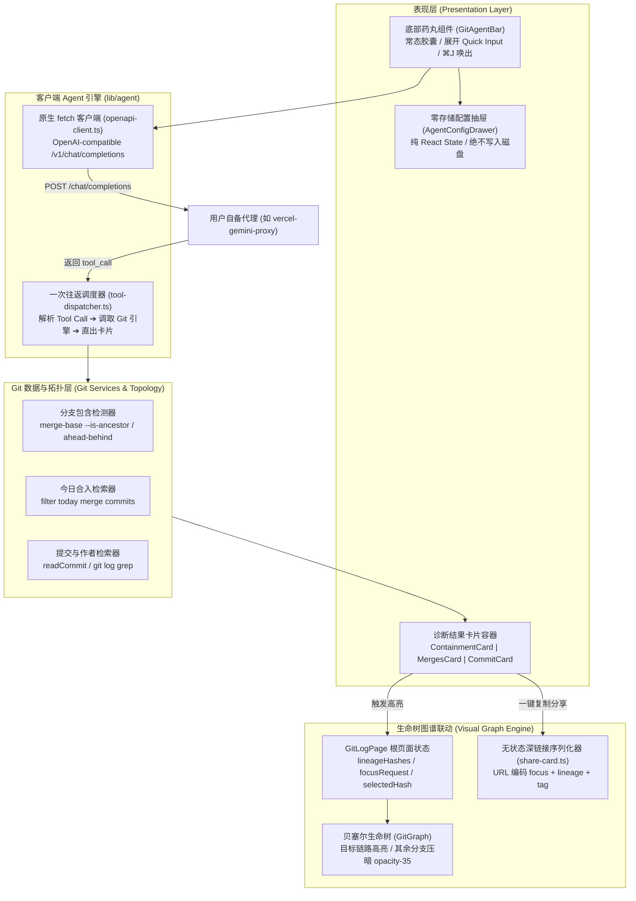

# Yggit — 居中药丸 Agent、零存储 OpenAPI 驱动与图谱标记分享技术设计

> 版本：V1.0  
> 状态：方案设计完成，待编码实施  
> 核心模块：`components/git/agent/*`, `lib/agent/*`, `components/git/GitGraph.tsx`, `components/git/GitLogPage.tsx`, `lib/git/share-card.ts`

---

## 1. 架构目标与总体数据拓扑

本模块为 Yggit 提供轻量、纯前端、零存储的 Agent 交互系统，并与 SVG 贝塞尔生命树图谱（`GitGraph`）形成深度联动。系统严格遵循 **BYOP (Bring Your Own Proxy) 客户端直连模式**，服务端零成本、无状态、无凭证持久化。

### 1.1 总体架构流向图



---

## 2. 零存储凭证模型 (Zero-Storage Security Specification)

为保障企业代码协作安全并杜绝在共享设备、会议室大屏或同事电脑上残留敏感密钥，凭证生命周期严格规范如下：

```typescript
export interface EphemeralAgentConfig {
  endpoint: string // e.g. "https://my-proxy.vercel.app/v1"
  apiKey?: string  // e.g. "sk-..."
  model: string    // e.g. "gemini-1.5-flash" or "deepseek-chat"
}
```

* **严格纯内存存储 (In-Memory Only)**：
  - `EphemeralAgentConfig` 只能作为局部状态存在于 React Context 或 `GitAgentBar` 的内部 `useState` 中；
  - **严禁**调用 `localStorage.setItem`、`sessionStorage.setItem`、`document.cookie`、IndexedDB 或发送给 Yggit 后端保存；
  - 页面刷新（F5）、标签页关闭、或点击面板上的“清空”按钮，凭证立即随内存回收彻底抹除。
* **CORS 友好型错误捕获**：
  - 若用户填写的直连 API（如未开启跨域的官方域名）触发了浏览器的 `TypeError: Failed to fetch` (CORS 错误)，客户端拦截并明确提示：
    > *“网络请求被浏览器拦截（CORS 跨域错误）。请使用已开启 CORS 的代理地址（如自建的 vercel-gemini-proxy 或 Cloudflare Worker 代理）。”*

---

## 3. OpenAPI 极简通信与 Tool Calling 规范

### 3.1 客户端请求实现 (`lib/agent/openapi-client.ts`)

无需任何第三方重型 SDK，纯原生 Web `fetch` 驱动：

```typescript
export async function sendAgentCompletion(
  config: EphemeralAgentConfig,
  messages: Array<{ role: 'user' | 'assistant' | 'system'; content: string }>,
  tools: AgentToolDefinition[],
  signal?: AbortSignal
): Promise<AgentCompletionResponse> {
  const url = `${config.endpoint.replace(/\/+$/, '')}/chat/completions`
  const headers: Record<string, string> = {
    'Content-Type': 'application/json',
  }
  if (config.apiKey?.trim()) {
    headers.Authorization = `Bearer ${config.apiKey.trim()}`
  }

  const response = await fetch(url, {
    method: 'POST',
    headers,
    body: JSON.stringify({
      model: config.model,
      messages,
      tools: tools.map((t) => ({ type: 'function', function: t })),
      tool_choice: 'auto',
    }),
    signal,
  })

  if (!response.ok) {
    const errorText = await response.text().catch(() => '')
    throw new Error(`Agent API Error (${response.status}): ${errorText || response.statusText}`)
  }

  return response.json()
}
```

### 3.2 预置 Git 工具定义 (Tool Definitions)

在向大模型发起请求时，注入以下 Function Calling 描述：

```typescript
export const AGENT_GIT_TOOLS = [
  {
    name: 'check_branch_containment',
    description: 'Check whether a source branch (e.g. feature branch) is already contained in a target branch (e.g. TEST or main), or if test contents accidentally leaked into feature branch.',
    parameters: {
      type: 'object',
      properties: {
        sourceBranch: { type: 'string', description: 'The source branch name, e.g. "feature/cart"' },
        targetBranch: { type: 'string', description: 'The target branch name, e.g. "TEST" or "main"' },
      },
      required: ['sourceBranch', 'targetBranch'],
    },
  },
  {
    name: 'get_today_merges',
    description: 'Get all branches and PRs merged into a specific branch today.',
    parameters: {
      type: 'object',
      properties: {
        targetBranch: { type: 'string', description: 'The branch to inspect, defaults to "TEST" or current branch' },
      },
      required: ['targetBranch'],
    },
  },
  {
    name: 'get_commit_details',
    description: 'Query author, date, and details of a specific commit by hash or commit message snippet.',
    parameters: {
      type: 'object',
      properties: {
        query: { type: 'string', description: 'Commit hash (short or full) or commit subject keyword' },
      },
      required: ['query'],
    },
  },
]
```

---

## 4. 图谱高亮联动与弱化实现 (Lineage Highlight & Dimming)

### 4.1 联动状态驱动 (`GitLogPage.tsx`)

`GitLogPage` 作为生命树和 Agent 的宿主容器，统一调度视口高亮：

```typescript
// 诊断高亮集合（包含被污染的合入点及相关父子提交）
const [lineageHashes, setLineageHashes] = useState<string[] | null>(null)
// 焦点请求（触发主视口平滑滚动并居中聚焦）
const [focusRequest, setFocusRequest] = useState<{ hash: string } | null>(null)
```

当 Agent 完成工具执行（如 `check_branch_containment` 发现分支包含关系）：
1. 提取所有关联 Commit Hash（合入 Commit + 来源分支提交点集合）：
   ```typescript
   setLineageHashes(['7a88b1', 'c128f9', 'f092e4'])
   setFocusRequest({ hash: '7a88b1' })
   setSelectedHash('7a88b1')
   ```
2. `GitGraph` 接收 `lineageHashes`：
   * **连线高亮**：
     ```typescript
     const isLineage = hasLineage && lineageHashes.has(stroke.hash)
     const strokeWidth = isLineage ? 3.5 : 1.8
     const opacity = hasLineage ? (isLineage ? 1 : 0.25) : 1
     ```
   * **提交行弱化**：
     ```typescript
     // 非链路中的行整体虚化至 35% 不透明度
     isLineageActive && !isLineageHit && !selected && !isHovered && 'opacity-35 hover:opacity-100'
     ```
   * **节点光晕**：
     ```typescript
     isLineageHit && 'ring-2 ring-accent ring-offset-1 scale-110 z-10 shadow-[0_0_8px_var(--accent)]'
     ```

---

## 5. 无状态深链接序列化与协同分享 (Stateless Deep Link Engine)

### 5.1 URL 编码规范

分享链接不依赖任何远程数据库，状态全部自包含在 URL 中：

```
/repo/[...slug]?focus=<commitHash>&lineage=<hash1,hash2,...>&targets=<hash:role,...>&reason=<tag>&desc=<encodedSummary>
```

* **`focus`**：主聚焦的目标 Commit Hash（打开时居中高亮并选中）；
* **`lineage`**：逗号分隔的关联脉络提交列表（用于图谱快速连线加粗与弱化其余分支）；
* **`targets`**：可选，细粒度角色映射（如 `hash:primary,hash:related,hash:candidate`），用于差异化光晕；
* **`reason`**：诊断类型与标记类型（例如 `risk:test-leak`、`audit:merge-audit`、`info:author-check`）；
* **`desc`**：可选，经 URI 编码的精简诊断摘要（例如 `feat/cart_contains_test`）。

### 5.2 接收端逆解析恢复流程 (`GitLogPage` 初始化)

在 `app/repo/[...slug]/page.tsx` 和 `GitLogPage.tsx` 初始化时挂载 URL 参数监听：

```typescript
useEffect(() => {
  if (typeof window === 'undefined') return
  const search = new URLSearchParams(window.location.search)
  const lineageParam = search.get('lineage')
  const focusParam = search.get('focus')

  if (lineageParam) {
    const hashes = lineageParam.split(',').map((h) => h.trim()).filter(Boolean)
    if (hashes.length > 0) {
      setLineageHashes(hashes)
    }
  }

  if (focusParam) {
    setSelectedHash(focusParam)
    setFocusRequest({ hash: focusParam })
  }
}, [])
```

### 5.3 剪贴板富文本与 Markdown 分享卡片 (`lib/git/share-card.ts`)

扩展现有 `lib/git/share-card.ts`，新增 `formatAgentDiagnosticShareCard`：

```typescript
export function formatAgentDiagnosticShareCard(options: {
  repoName: string
  title: string
  detail: string
  focusHash: string
  lineageHashes: string[]
  shareUrl: string
}): { markdown: string; plain: string } {
  const markdown = [
    `🔍 **[Yggit 诊断与脉络排查分享]**`,
    `- **仓库**：${options.repoName}`,
    `- **诊断结论**：${options.title}`,
    `- **详情**：${options.detail}`,
    `- **关键提交节点**：\`${options.focusHash.slice(0, 7)}\` (共高亮 ${options.lineageHashes.length} 个关联点)`,
    `👉 **[点击直接在 Yggit 中查看高亮拓扑与差异](${options.shareUrl})**`,
  ].join('\n')

  return { markdown, plain: markdown.replace(/\*\*/g, '').replace(/\[(.*?)\]\((.*?)\)/g, '$1: $2') }
}
```

---

## 6. 组件结构与模块拆分清单

```
components/git/agent/
├── GitAgentBar.tsx             # 页面居中药丸入口 + 展开 Command Palette 弹层
├── AgentConfigDrawer.tsx       # 零存储内存配置插槽 (Base URL, Key, Model)
├── AgentPromptChips.tsx        # 快捷气泡 (今日合并、分支包含、查作者)
├── AgentResultContainer.tsx    # 诊断卡片容器
└── cards/
    ├── BranchContainmentCard.tsx # 分支包含诊断卡片（带高亮按钮 & 一键复制卡片）
    ├── TodayMergesCard.tsx       # 今日合并列表卡片（带分支来源与高亮切换）
    └── CommitDetailsCard.tsx     # 提交作者详情卡片

lib/agent/
├── types.ts                    # Agent 与 Tool 调用类型定义
├── openapi-client.ts           # 原生 fetch 驱动的 OpenAI-compatible 客户端
├── tools.ts                    # AGENT_GIT_TOOLS 定义
└── diagnostic-dispatcher.ts    # Tool 返回值与 Git 数据层调度中枢

lib/git/
└── share-card.ts               # 扩展支持 Agent 诊断深链接序列化与格式化
```

---

## 7. 实施计划 (Implementation Roadmap)

| 阶段 | 实施任务 | 交付物 |
|---|---|---|
| **Phase 1** | 核心通信与工具集封装 | `lib/agent/openapi-client.ts`, `lib/agent/tools.ts`, `services/git/agent-tools.ts` |
| **Phase 2** | 居中药丸入口与内存配置 | `components/git/agent/GitAgentBar.tsx`, `AgentConfigDrawer.tsx` (无持久化) |
| **Phase 3** | 图谱联动与高亮弱化绑定 | `GitLogPage.tsx` 联动 `lineageHashes` 与 `GitGraph.tsx` 动态高亮 |
| **Phase 4** | 无状态深链接分享与 URL 还原 | `lib/git/share-card.ts` 扩展与接收端 URL query 自动聚焦还原 |
