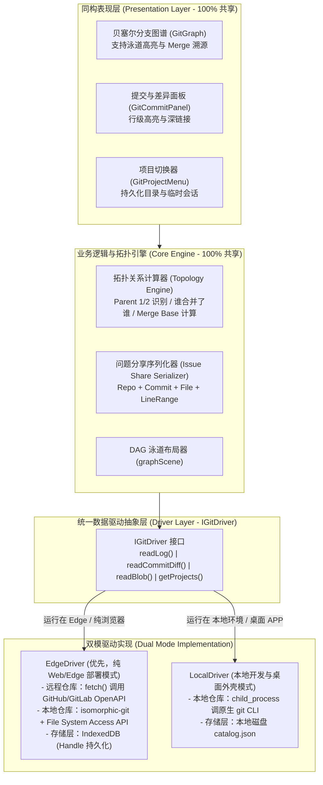
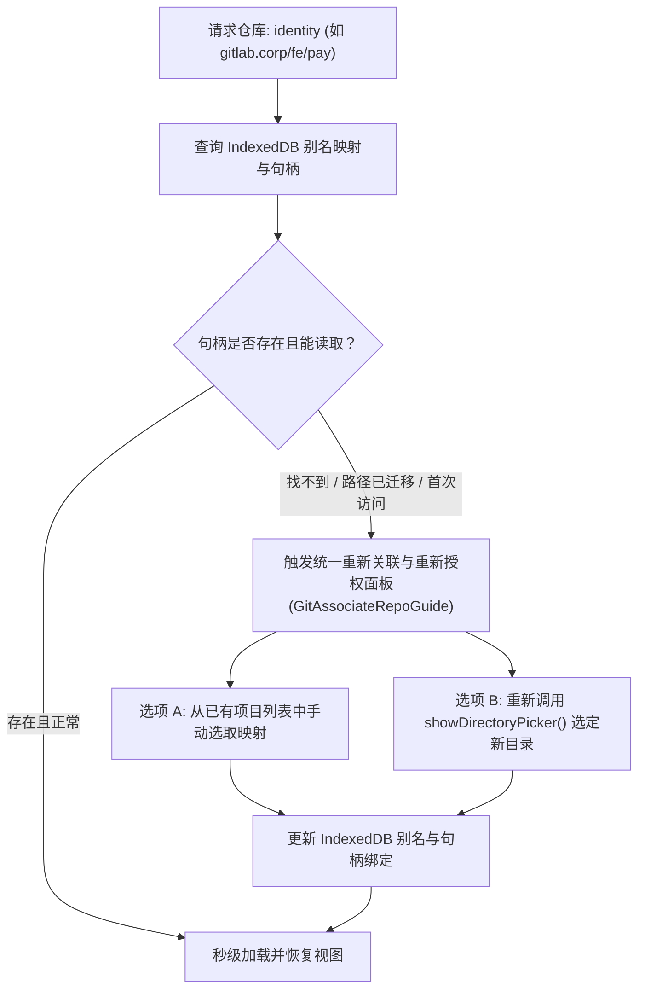

# Yggit — 面向 Edge 与双模架构的技术设计与实现规范

> 版本：V1.0  
> 状态：方案设计完成，待编码实施  
> 核心模块：`lib/git/driver/*`, `lib/git/topology/*`, `components/git/*`, `services/git/*`

---

## 1. 架构目标与总体拓扑

为了解决传统 Git 工具“必须本地安装、沟通依赖死截图、CLI 难以分辨谁合并到谁”的核心痛点，Yggit 架构全面转向 **Web/Edge-First**。

### 1.1 核心分层设计（同构双模分层）



---

## 2. 驱动层抽象规范 (`IGitDriver`)

所有前端视图（`GitLogPage`、`GitGraph`、`GitCommitPanel`）严禁直接调用具体的 Node 接口或特定的浏览器句柄，统一面向 `IGitDriver` 编程：

```typescript
export interface IGitDriver {
  readonly mode: 'edge' | 'local'

  // 读取分支、标签、图谱提交列表
  readLog(options: { repo: string; branch?: string; ref?: string; skip?: number }): Promise<GitLogView>

  // 读取提交修改项与差异
  readCommitDiff(options: { repo: string; hash: string }): Promise<GitCommitChanges>

  // 读取文件内容 Blob
  readBlob(options: { repo: string; hash: string; path: string }): Promise<{ content: string; binary: boolean }>

  // 获取已保存项目列表
  getProjects(): Promise<GitProjectView[]>

  // 添加/关联本地或远程项目
  addProject(payload: { pathOrUrl: string; handle?: FileSystemDirectoryHandle }): Promise<GitProjectView>
}
```

### 2.1 EdgeDriver 的实现关键

1. **远程仓库模式**：
   - 使用 Web 标准 `fetch()` 直连 GitHub / GitLab REST API；
   - Edge Worker 充当轻量反向代理，解决企业内网 GitLab 的 CORS 跨域问题。
2. **本地文件夹模式（无 Node、免安装）**：
   - 依赖 `window.showDirectoryPicker()` 获取 `FileSystemDirectoryHandle`；
   - 采用行业权威库 **`isomorphic-git`** 作为 Git 协议解析引擎；
   - 通过 **`ZenFS` (`@zenfs/dom`)** 将目录句柄挂载为虚拟 POSIX 文件系统；
   - 将目录句柄直接存入浏览器 **IndexedDB**，实现页面刷新（F5）与重开浏览器的**零弹窗静默恢复**。

### 2.2 LocalDriver 的实现（本地兼容与 CHAYA 同构模式）

- 当在本地开发或打包为桌面应用（Tauri / Electron）时，系统检测到 Node 宿主环境，自动激活 `LocalDriver`。
- 直接复用现有 `services/git/read.ts` 与 `child_process.execFile('git')`，发挥本地 C 语言原生极速优势。

---

## 3. “谁合并了谁”分支拓扑溯源引擎 (Topology Engine)

针对命令行 CLI 中“只给 Commit Hash 根本看不出分支合并脉络”的痛点，新增 `TopologyEngine` 计算模块：

```mermaid
flowchart LR
    Commit["Merge Commit (例如 7f0b0d8)<br/>parents: [P1, P2]"]
    --> Split{"Parent 角色判定"}

    Split -->|Parent 1 (第一父提交)| TargetBranch["🎯 接收分支 (Target / Base)<br/>例如 main / master"]
    Split -->|Parent 2 (第二父提交)| SourceBranch["🌿 合入分支 (Source / Feature)<br/>例如 feature/pay-v2"]

    TargetBranch & SourceBranch --> Trace["双向拓扑回溯"]
    Trace --> FindBase["计算分歧基准点 (Merge Base Commit)"]
    FindBase --> CommitsRange["计算本次合入包含的所有提交清单 (P2..P1)"]
```

### 3.1 核心算法实现规范

```typescript
export interface MergeTopologyInfo {
  isMerge: boolean
  targetBranchHint?: string // 目标接收分支（如 main）
  sourceBranchHint?: string // 被合并的功能分支（如 feature/user-auth）
  mergeBaseHash?: string // 两分支的分歧点 Commit
  commitsIncluded: string[] // 该合并引入的具体提交 Hash 列表
}

export function analyzeMergeTopology(commit: GitCommit, commitMap: Map<string, GitCommit>): MergeTopologyInfo {
  if (!commit.parents || commit.parents.length < 2) {
    return { isMerge: false, commitsIncluded: [] }
  }

  const p1 = commit.parents[0] // 目标主干（Target）
  const p2 = commit.parents[1] // 来源分支（Source Feature）

  // 从 Commit Message 正则解析分支意图
  // 例如: Merge branch 'feature/foo' into main
  // 或者: Merge remote-tracking branch 'origin/feature/foo' into test
  const match = commit.subject.match(/Merge (?:branch|remote-tracking branch) '([^']+)'(?: into ([^\s]+))?/i)
  const sourceBranchHint = match ? match[1] : undefined
  const targetBranchHint = match ? match[2] : undefined

  // 回溯 P2 链路，直到触达与 P1 的共同祖先 (Merge Base)
  const commitsIncluded = traceLineageBetween(p2, p1, commitMap)

  return {
    isMerge: true,
    targetBranchHint,
    sourceBranchHint,
    commitsIncluded,
  }
}
```

### 3.2 交互表现

- **生命图谱高亮**：悬停或选定 Merge Commit 时，属于 `Source Branch` 的连线与节点呈现高光呼吸动效，主干分支呈现基准线，直观区分。
- **详情侧栏面包屑**：以 Tag 展示 `[🌿 feature/login] ➔ [🎯 main]`，点击任意提交直接定位到引入源头。

---

## 4. 精准问题状态序列化与一键分享体系

为了彻底替代“截静态死图”的低效沟通，URL 成为**可完全还原调试现场的载体**：

### 4.1 URL 结构与参数规范

```text
/repo/{identity}/commit/{sha}?file={path}&lines={start}-{end}&focus={source|target}
```

- `{identity}`：公共仓库为 `github/{owner}/{repo}`，企业私有为 `{host}/{group}/{repo}`，纯本地离线为 `l_{hash}`。
- `{sha}`：目标提交 Hash。
- `file`（可选）：当前正在审查的文件路径。
- `lines`（可选）：发生问题的代码行号区间（如 `24-48`）。
- `focus`（可选）：针对 Merge Commit 聚焦查看合入分支（`source`）还是目标分支（`target`）。

### 4.2 结构化 Markdown 卡片生成器

在 `lib/git/share-card.ts` 中实现剪贴板标准卡片生成：

```typescript
export function formatIssueShareCard(payload: { repoName: string; commit: GitCommit; file?: string; lines?: string; url: string; topology?: MergeTopologyInfo }): string {
  const linesInfo = payload.lines ? ` (L${payload.lines})` : ''
  const topologyInfo = payload.topology?.isMerge
    ? `\n- **合并脉络**：\`${payload.topology.sourceBranchHint || 'feature'}\` ➔ \`${payload.topology.targetBranchHint || 'target'}\``
    : ''

  return [
    `🔍 **[Yggit 代码问题排查]**`,
    `- **仓库**：${payload.repoName}`,
    `- **提交**：\`${payload.commit.short}\` — ${payload.commit.subject}`,
    topologyInfo,
    payload.file ? `- **问题文件**：\`${payload.file}\`${linesInfo}` : '',
    `👉 **[点击在 Yggit 中交互式审查拓扑与差异]**(${payload.url})`,
  ]
    .filter(Boolean)
    .join('\n')
}
```

---

## 5. 本地目录持久化、工作区感知与重授权机制

### 5.1 目录句柄在 IndexedDB 中的持久化规范

在 `lib/git/indexeddb-handles.ts` 中，使用原生 `idb` 或简单包装实现句柄持久化：

```typescript
const DB_NAME = 'yggit_handles_store'
const STORE_NAME = 'directory_handles'

// 存储授权句柄
export async function saveDirectoryHandle(repoId: string, handle: FileSystemDirectoryHandle): Promise<void> {
  const db = await openDatabase()
  const tx = db.transaction(STORE_NAME, 'readwrite')
  await tx.objectStore(STORE_NAME).put({ id: repoId, handle, updatedAt: Date.now() })
}

// 恢复授权句柄（免重新选文件夹）
export async function getDirectoryHandle(repoId: string): Promise<FileSystemDirectoryHandle | null> {
  const db = await openDatabase()
  const tx = db.transaction(STORE_NAME, 'readonly')
  const record = await tx.objectStore(STORE_NAME).get(repoId)
  if (!record?.handle) return null

  // 校验当前权限状态
  const permission = await record.handle.queryPermission({ mode: 'read' })
  if (permission === 'granted') {
    return record.handle
  }
  return record.handle
}
```

### 5.2 权限生命周期与静默恢复机制 (Permissions Lifecycle & Silent Restore)

- **持久权限（Persistent Permissions）**：针对 Chrome 122+ / Edge 等支持长期授权的浏览器，用户勾选「每次访问都允许」后，刷新页面（F5）或次日重新打开网页，句柄状态为 `granted`，系统**100% 自动静默读取本地工程，零弹窗、零中断**。
- **单次唤醒（Fallback Activation）**：在权限过期或新会话需激活时，当用户点击项目列表项，系统调用 `handle.requestPermission({ mode: 'read' })`，地址栏下方轻量弹窗单击「允许」即可恢复，绝无需重新打开文件系统对话框去硬盘翻找。

### 5.3 统一资源未定位、路径迁移与重新授权机制 (Resource Re-association Engine)

在去中心化 Web 架构中，系统将以下场景归一化为**统一的未定位状态（RESOURCE_UNRESOLVED）**：

1. 打开未曾绑定的私有/自建 GitLab 仓库分享链接；
2. 本地目录被移动（从 `/Users/.../dev` 迁移到 `/Users/.../work`）；
3. 操作系统文件夹被重命名或磁盘句柄失效；
4. 开发者主动切换本地绑定的多 Worktree 副本。



通过这一归一化机制，系统无需针对“404”、“文件不存在”、“权限过期”编写凌乱的补丁，用户随时拥有**自愈修复和灵活重连**的权利。

### 5.4 本地工作区修改（Uncommitted Changes）的高性能感知策略 (Worktree Fast Diff)

针对纯浏览器在缺少原生 `fsevents` 文件监听时如何快速查看本地修改的痛点，系统设计三级快速比对引擎：

1. **切回窗口聚焦事件驱动（Focus-Driven Auto-Refresh）**：
   监听 `window.addEventListener('focus', onWindowFocus)`。当开发者在 VS Code / Cursor 编辑代码后切回 Yggit 网页标签，系统自动静默触发工作区比对。
2. **mtime 预过滤与局部哈希扫描（Fast mtime Pruning）**：
   通过 `isomorphic-git` 的 `statusMatrix`，优先比对文件的修改时间戳（mtime）与文件大小（size）。未变动的文件直接跳过，仅对发生变动的文件计算 SHA-1，将中型项目（数千文件）的扫描比对耗时压缩至 50ms 以内。
3. **工作区置顶虚拟节点（Virtual Worktree Node）**：
   比对结果在生命图谱最顶层渲染为 `GIT_WORKTREE_HASH`（带有工作区修改徽标与文件变动数），点击即可在右侧展开未提交 Diff，保持与桌面客户端完全一致的交互体验。

---

## 6. 实施路线图（Phases）

1. **Phase 1（P0，基础框架与共享引擎）**：
   - 抽象 `IGitDriver` 接口，解耦现有 `services/git/read.ts` 与视图层。
   - 实现精确 URL 序列化（Commit + File + Lines）与 Markdown 结构化分享卡片。
2. **Phase 2（P0，拓扑溯源引擎）**：
   - 实现 `TopologyEngine`，在图谱与侧栏突出显示 Merge Commit 的“谁合并到了谁”。
   - 增加分支染色与连线脉络单键高亮。
3. **Phase 3（P0，Web File System Access 与 Edge 适配）**：
   - 引入 `isomorphic-git` + `ZenFS` 驱动本地目录句柄。
   - 实现 IndexedDB 句柄持久化与 `window.onfocus` 局部快速比对。
4. **Phase 4（P1，双模开关与本地极速通道）**：
   - 增加前端模式切换开关（Edge 纯 Web 模式 vs 本地 Node 极速模式），满足在本地开发环境直接榨干 C 语言 CLI 极限性能的需求。
