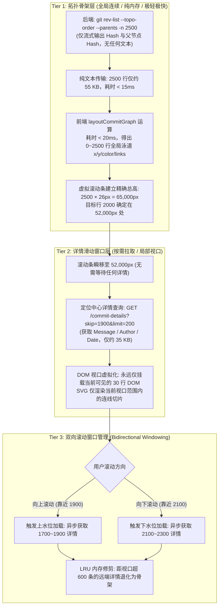
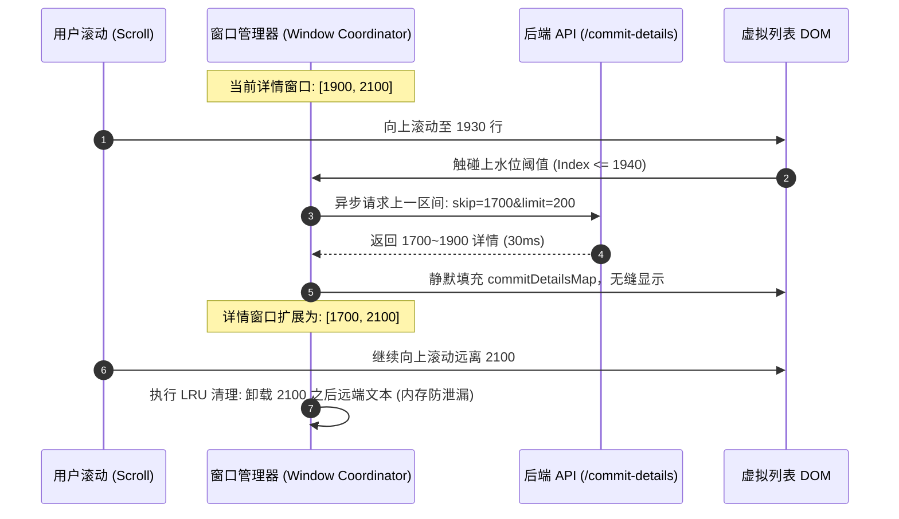

# Git 图谱大规模历史检索与双向窗口虚拟滚动技术设计方案

> **文档标识**：WT-RFC-2026-GIT-VIRTUAL-WINDOW  
> **适用模块**：`components/git/`、`services/git/`、`lib/git/`  
> **目标**：解决深层历史节点（如 2000+ 条之前）点击分支无法直达、全量加载 DOM 节点爆炸、以及单纯按切片拉取导致 Git 图谱断头错位的工程难题。

---

## 1. 背景与问题陈述

### 1.1 现状与瓶颈

- **单向有限加载**：当前 Yggdrasil Git 模块采用首屏 `GIT_LOG_PAGE_SIZE = 40` 条提交的单向懒加载机制。
- **深层分支定位失灵**：当用户在左侧分支树中点击一个陈旧分支（如 2000 个提交以前合并的特性分支或归档发布分支），该分支的 HEAD Commit 并不在内存中。前端虽尝试通过逐页 `loadMore()` 查找，但在跨度巨大时需要发起数十次连续串行请求，导致界面假死、请求超时或无限 Loading，无法直达定位。
- **DOM 渲染爆炸**：如果粗暴地将 0～2000 条全量拉取并渲染进 DOM，页面将堆积超过 **20,000+ 个 DOM 节点** 和 **4,000+ 条 SVG 贝塞尔曲线**，导致 React 重渲染严重掉帧、滚动卡顿（FPS < 15）。

### 1.2 为什么朴素的“中间按时间/偏移切片”不可行？

用户希望以 200 条为区间（如当前在 2000 条时，只加载 1900～2100 条），并实现上下双向滚动动态补全。然而，**在 Git 有向无环图（DAG）中，直接执行 `git log --skip 1900 -n 200` 会引发拓扑灾难**：

1. **主干线（Trunk）凭空蒸发**：若 `main` 分支在此 200 条提交期间无自身 Commit，切片数据中完全不包含 `main`，导致主干轨道在此区间凭空消失。
2. **两端断头与泳道跳跃（Dangling Rails）**：Git 泳道（Lane）位置与颜色是自上而下逐行累计的状态机。若第 1900 行孤立排版，引擎会误把第 1900 行当作主干放入 Lane 0；当用户向上拉回 1700～1900 时，第 1899 行的线在 Lane 3，第 1900 行在 Lane 0，边界处会出现极其丑陋的横向飞线与颜色突变。
3. **滚动条抖动（Scroll Jitter）**：缺乏全局拓扑位置，前端无法预知 1900 行之前到底有多少真实行高，滚动条滑块无法定位。

---

## 2. 核心架构：二阶解耦模型（2-Tier Decoupled Architecture）

为了既满足**轻量局部加载（仅拉 200 条详情）**，又保证**图谱连线 100% 连续且全局坐标精准**，系统采用**拓扑骨架（Topology Skeleton）**与**提交详情（Commit Details）**彻底分离的二阶模型：



---

## 3. 详细技术实现方案

### 3.1 阶段一：极速全局骨架提取（Skeleton Pipeline）

后端提供轻量化拓扑元数据端点：

- **命令行执行**：
  ```bash
  git rev-list --topo-order --parents --branches --tags --remotes --date-order -n 3000 HEAD
  ```
- **输出数据结构（纯紧凑数组）**：
  ```json
  [
    ["9f8e4a1", ["b2c3d4e"]],
    ["b2c3d4e", ["c3d4e5f", "a1a2a3a"]],
    ["c3d4e5f", ["root001"]]
  ]
  ```
- **性能特征**：3,000 条记录在本地 Git 执行仅需 10～18ms，JSON 体积仅 ~60KB。
- **全局布局运算**：
  - 前端利用现有 `lib/git/graph.ts` 的 `layoutCommitGraph` 计算每行所属 Lane、颜色索引、连线关系。
  - 生成全局位置索引表 `HashMap<Hash, { rowIndex: number, lane: number, color: number }>`。
  - 确定滚动容器物理总高度：`TotalHeight = Skeleton.length * ROW`。

---

### 3.2 阶段二：区间详情滑动窗口（200-Commit Sliding Window）

当定位到第 2000 行时，前端根据目标行号动态划定加载区间：

- **窗口计算公式**：
  $$\text{WindowStart} = \max(0, \text{TargetIndex} - 100)$$
  $$\text{WindowEnd} = \min(\text{Skeleton.length}, \text{TargetIndex} + 100)$$
  例如：目标为 2000 时，拉取区间为 `[1900, 2100]`，共 200 条。
- **增量详情查询接口**：
  `GET /api/git/commit-details?repo=...&skip=1900&limit=200`
- **详情内存池**：
  前端维护 `commitDetailsMap: Map<string, GitCommitDetail>`，将拉取到的 200 条提交信息（Subject、Author、Refs、Date）填入映射表中。

---

### 3.3 阶段三：视口虚拟滚动与 SVG 局部切片渲染

- **DOM 虚拟化**：
  - 基于当前视口 `scrollTop` 计算可见行范围：
    $$\text{VisibleStart} = \lfloor \text{scrollTop} / \text{ROW} \rfloor - \text{Overscan}$$
    $$\text{VisibleEnd} = \lceil (\text{scrollTop} + \text{ViewportHeight}) / \text{ROW} \rceil + \text{Overscan}$$
  - 其中 $\text{Overscan} = 5$（上下各缓冲 5 行）。视口内实际渲染的 DOM 元素恒定在 **30～40 个**，杜绝卡顿。
- **骨架占位态（Skeleton Placeholder）**：
  - 在详情尚未到达的行（例如用户高速滚动时），行文本显示微光骨架条或短 Hash，**但左侧图谱的连线与节点圆圈直接由骨架层精准绘制**，视觉绝不断线。
- **SVG 连线局部切片**：
  - SVG 不再渲染全局几千条路径，而是通过 `scene.strokes.filter(s => s.y2 >= visibleTop && s.y1 <= visibleBottom)`，仅渲染当前可见高度区间内的几十条 `<path>`，GPU 渲染开销降低 98%。

---

### 3.4 阶段四：双向滚动水位线管理（Bidirectional Windowing Coordinator）

为了让用户无感地上下漫游，窗口管理器监听滚动事件并维护水位线：



1. **上水位线（Upper Threshold）**：当视口首行接近当前窗口下界（`VisibleStart <= WindowStart + 40`）时，自动触发拉取前一个区间 `[WindowStart - 200, WindowStart]`。
2. **下水位线（Lower Threshold）**：当视口末行接近当前窗口上界（`VisibleEnd >= WindowEnd - 40`）时，自动触发拉取后一个区间 `[WindowEnd, WindowEnd + 200]`。
3. **内存 LRU 淘汰策略**：
   - 内存池最多保留连续的 **600 条** 详情（约 3 个窗口）。
   - 超出视口范围达 400 条以上的远端条目，释放其完整文本引用（保留纯 Hash 骨架），确保移动端或低内存设备长期滚动也不爆内存。

---

## 4. API 接口契约规范

### 4.1 获取拓扑骨架（流式/纯数组）

- **路径**：`GET /api/git/topology`
- **Query 参数**：
  - `repo`: 仓库绝对路径
  - `max`: 最大扫描提交数（默认 `5000`，超大型仓可配置）
- **响应格式**：
  ```json
  {
    "total": 2480,
    "branches": { "feature/JZY-3340": "a1b2c3d" },
    "nodes": [
      ["a1b2c3d", ["b2c3d4e"], 1700000000],
      ["b2c3d4e", ["c3d4e5f", "d4e5f6a"], 1699990000]
    ]
  }
  ```

### 4.2 获取区间提交详情（窗口批次）

- **路径**：`GET /api/git/log`（复用现有历史接口，支持扩展 `limit`）或 `GET /api/git/commit-details`
- **Query 参数**：
  - `repo`: 仓库路径
  - `skip`: 偏移行号（如 `1900`）
  - `limit`: 区间大小（默认 `40`，窗口加载传 `200`）
- **响应格式**：
  ```json
  {
    "skip": 1900,
    "hasMore": true,
    "commits": [
      {
        "hash": "a1b2c3d4e5f6...",
        "short": "a1b2c3d",
        "subject": "feat: 支持 robots 默认模板识别",
        "author": "David",
        "date": "2026-11-14T18:30:00Z",
        "refs": ["feature/JZY-3340"]
      }
    ]
  }
  ```

### 4.3 目标 Commit 定位查询（快速测距）

- **路径**：`GET /api/git/locate`
- **Query 参数**：
  - `repo`: 仓库路径
  - `target`: 目标 Commit Hash 或分支名
- **响应格式**：
  ```json
  {
    "hash": "a1b2c3d4e5f6...",
    "rowIndex": 2042,
    "recommendedWindow": { "skip": 1942, "limit": 200 }
  }
  ```

---

## 5. 体验降级与快速替代路径（Fallback Strategy）

在大型系统实现完整虚拟滚动的周期内，建议同时提供**零成本降级通道**：

- **分支作用域查看（Branch Scope）**：
  - 在左侧分支右键菜单或双击时，支持选择 **“查看该分支独立历史（Branch Log）”**。
  - 系统切换执行 `git log <branch_name>`，此时该分支最新 HEAD 直接位于 **第 0 行**，无需向后滚动几千行，首屏 10ms 秒开。

---

## 6. 实施路线图（Milestones）

| 阶段                       | 交付内容                                                           | 验收标准                                       |
| :------------------------- | :----------------------------------------------------------------- | :--------------------------------------------- |
| **M1: 后端骨架与分批接口** | 现有 `/api/git/log` 扩展 `limit`，新增轻量拓扑 `/api/git/topology` | 2,500 条骨架提取 < 25ms，200 条详情拉取 < 20ms |
| **M2: 前端虚拟列表重构**   | `GitGraph.tsx` 集成虚拟滚动容器，SVG 实施可视高度切片渲染          | DOM 节点数恒定在 30~40 个，60fps 顺畅滚动      |
| **M3: 双向滑动窗口集成**   | 接入窗口管理器，监听上下水位线进行双向静默回填与 LRU 释放          | 上下快速滑动无白屏断流，内存占用稳定 < 50MB    |
| **M4: 分支点击直达联调**   | 点击左侧任意陈旧分支，调用定位接口瞬间直达第 2000+ 行并拉取该窗口  | 点击后 < 80ms 视口平滑定位至目标行，连线无断裂 |

## 7. 边界异常与容灾策略 (Edge Cases & Resilience)

1. **空仓库或无提交（Empty Repo）**：
   - `git rev-list` 会返回退出码 128 或 `does not have any commits`，后端捕获并安全回退为 `{ total: 0, nodes: [] }`，界面展示优雅空态。
2. **游离 HEAD 状态（Detached HEAD）**：
   - 参数中显式包含 `HEAD`（`--branches --tags --remotes HEAD`），确保即使处于 rebase 或检出特定 commit 状态，HEAD 节点仍然作为第一条被捕捉到。
3. **Stash 隔离与避免污染**：
   - 严禁使用 `--all` 抓取骨架，因为 `--all` 会遍历 `refs/stash`，导致暂存区的内部 index 与 untracked 提交被误绘为普通提交。Stash 继续由现有的独立暂存通道计算。
4. **大仓性能基准（10,000+ Commits）**：
   - 骨架拉取默认 `max = 5000`，对超巨型 monorepo，首期定位只需算出目标点前后的拓扑骨架区间，无需一次性遍历数十万条历史。
