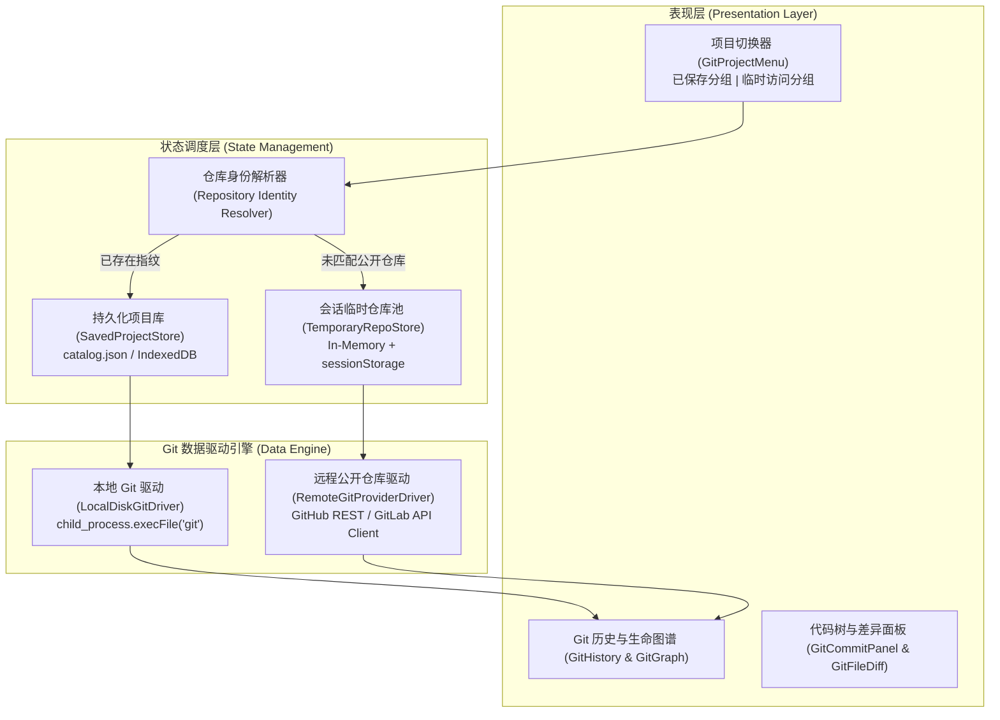

# Yggit — 临时仓库访问与收藏管理技术方案 (Technical Architecture Specification)

> 版本：V1.0  
> 状态：方案设计完成，待编码实现  
> 模块：`lib/git/temporary-store.ts`, `components/git/GitProjectMenu.tsx`, `services/git/remote-provider.ts`, `app/api/git/*`

---

## 1. 架构目标与总体拓扑

为了满足「打开即看，收藏才保存」的产品原则，系统需在不破坏现有本地 Git 仓库读取能力（DiskOps / local `git` CLI）的前提下，引入轻量化会话级临时仓库架构与远程 Git Provider 数据源适配。

### 1.1 核心分层架构



---

## 2. 详细设计

### 2.1 临时项目存储 (`TemporaryRepoStore`)

临时项目仅保存在当前会话，确保不会写入本地物理磁盘配置 `data/git-projects/catalog.json`。

#### 数据结构
```typescript
export interface TemporaryRepo {
  id: string               // e.g. "temp_github_davidkk_yggit"
  name: string             // e.g. "DavidKk/yggit"
  remoteUrl: string        // e.g. "https://github.com/DavidKk/yggit"
  fingerprint: string      // e.g. "github.com/davidkk/yggit"
  provider: 'github' | 'gitlab' | 'generic'
  defaultBranch?: string   // e.g. "main"
  createdAt: number        // timestamp
}
```

#### 会话生命周期与客户端同步
- **读取**：客户端通过 `useSyncExternalStore` 或 `useState` + `useEffect` 挂载 `sessionStorage.getItem('yggit.temporary_repos')`，规避 SSR / CSR 水合不一致。
- **添加**：用户打开分享 URL 或在切换器输入远程 URL 时，通过指纹比对：
  - 若 `SavedProjectStore` 已存在相同 `fingerprint`，则直接切换到该已保存项目，不增加临时条目。
  - 若不存在，生成 `TemporaryRepo` 并写入会话存储。
- **收藏 (Promote to Saved)**：
  - 调用 `POST /api/git/projects` 将该项目的 `name`, `remoteKey`, `httpsUrl` 持久化写入 `catalog.json`。
  - 同时从 `TemporaryRepoStore` 移除该条目，界面无感迁移至「已保存项目」区域。
- **移除 (Dismiss)**：
  - 从 `TemporaryRepoStore` 移除该条目。
  - 若当前正处于该仓库视图，自动退回上一个已保存仓库或激活空态界面。

---

### 2.2 远程公开仓库驱动 (`RemoteGitProviderDriver`)

当用户访问尚未克隆的公开 GitHub 仓库时，系统通过轻量化 Remote Provider 提供 Git 历史、提交信息与 Diff 视图，无需在本地执行全量 `git clone`。

#### 核心能力支持
1. **Commit Log 分页获取**：
   - 目标：对接 `https://api.github.com/repos/{owner}/{repo}/commits`。
   - 映射为统一的 `GitCommit` 结构（hash, parentHashes, subject, author, date, refs）。
2. **分支与标签获取**：
   - 对接 `/repos/{owner}/{repo}/branches` 与 `/tags`。
   - 组装为轻量分支引用，供给 `GitSidebar` 与 `GitGraph` 渲染分支图谱。
3. **Commit 差异与文件树**：
   - 对接 `/repos/{owner}/{repo}/commits/{ref}` 获取变更文件列表及 stats。
   - 对接 `/repos/{owner}/{repo}/git/trees/{tree_sha}` 获取完整文件目录树。
4. **代码 Diff 与 Blob 预览**：
   - 支持通过 API 获取单个文件的 patch 或 raw blob 内容，无缝喂入 `GitFileDiff` 和 `GitFilePreview`。

#### 降级与限流保障
- **内存缓存 (Memory Cache)**：对同一 commit sha 和 ref 设置 5 分钟 LRU 缓存，避免频繁翻页触发 API 限流。
- **未认证降级**：当未配置 PAT 且达到 60 req/hr 阈值时，返回清晰的 `429 Too Many Requests`，前端展示友好提示框，引导用户提供只读 Token 或点击「一键克隆至本地」。

---

### 2.3 项目切换器 (Project Switcher) 组件重构

在 `components/git/GitProjectMenu.tsx` 中做如下增强：
1. **搜索栏 URL 嗅探**：
   - 实时判断搜索框文本是否匹配 `http(s)://` 或 `git@` 远程仓库格式。
   - 若匹配且当前目录不存在，动态在下拉面板首行显示：
     `[🌐 临时打开远程公开仓库: {repoName}]`，按回车立即加载。
2. **专属临时分组 (`TemporarySection`)**：
   - 条件渲染：当 `temporaryRepos.length > 0` 时展示。
   - 独立视觉徽章：带浅色 Accent Badge（如 `t('git.project.temporary')`）。
   - 快速操作栏：
     - ⭐ 收藏按钮：触发 `onFavorite(tempRepo)`。
     - ✕ 移除按钮：触发 `onRemoveTemporary(tempRepo.id)`。
3. **平滑过渡与动画**：
   - 收藏动作执行后触发微交互，星标点亮并从临时组淡出、在主列表高亮出现，操作体验丝滑连贯。

---

## 3. 自我代码评审 (Self-CR) 与方案修正

在方案设计与预审过程中，识别出以下潜在风险及修正对策：

| 发现问题 / 潜在缺陷 | 影响范围 | 修正对策 |
|---|---|---|
| **CR-1: URL 状态污染与前进后退** | 浏览器历史记录 | 临时仓库使用 `/repo?remote={url}` 或在 URL 参数保留指纹，使用 `window.history.pushState`，确保浏览器前进/后退能正确恢复临时仓库上下文。 |
| **CR-2: 远程 API 数据格式与本地 Git CLI 差异** | `GitHistory` 图谱连线 | 远程 API 返回的提交列表可能只有 parents sha，没有本地完整的 `git log --graph` 拓扑。系统复用已实现的客户端 DAG 布局计算器 `graphScene()`，以 parent 关系为基准纯前端计算连线与泳道，确保两端渲染效果 100% 一致。 |
| **CR-3: 离线环境与测试环境** | 自动化测试与离线运行 | `services/git/remote-provider.ts` 内置 Mock/Fixture 机制，在无网络连接或离线测试模式下，可自动降级或使用离线沙箱数据，保障测试用例稳定跑通。 |
| **CR-4: 收藏后重复创建** | 数据完整性 | 收藏 API 在执行写入前强制执行规范化指纹匹配检查。若已存在直接返回已保存项目，杜绝产生重复冗余条目。 |
