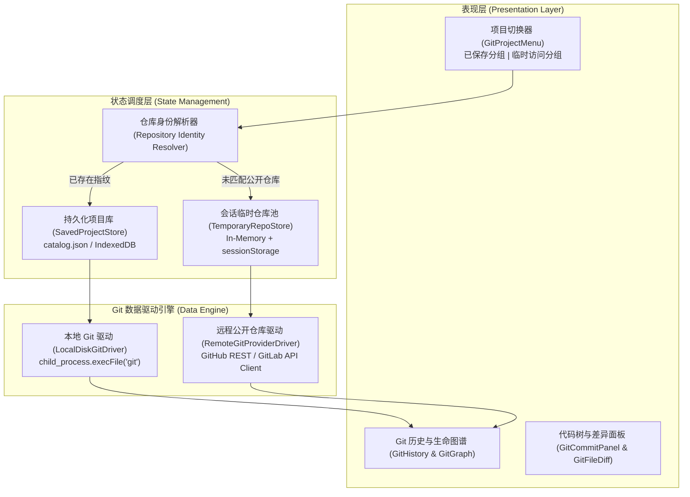
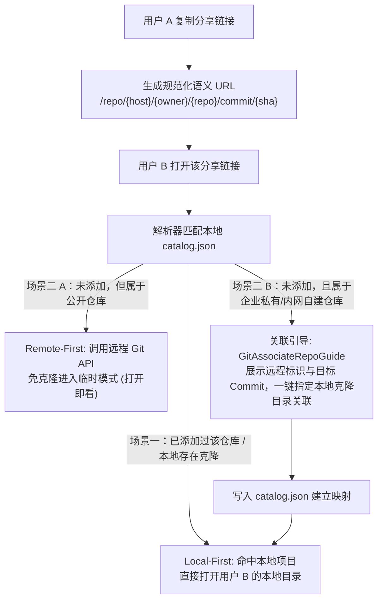

# Yggit — 临时仓库访问与收藏管理技术方案 (Technical Architecture Specification)

> 版本：V1.0  
> 状态：方案设计完成，待编码实现  
> 模块：`lib/git/temporary-store.ts`, `components/git/GitProjectMenu.tsx`, `services/git/remote-provider.ts`, `app/api/git/*`

---

## 1. 架构目标与总体拓扑

为了满足「打开即看，收藏才保存」的产品原则，系统需在不破坏现有本地 Git 仓库读取能力（DiskOps / local `git` CLI）的前提下，引入轻量化会话级临时仓库架构与远程 Git Provider 数据源适配。

### 1.1 核心分层架构



---

## 2. 详细设计

### 2.1 临时项目存储 (`TemporaryRepoStore`)

临时项目仅保存在当前会话，确保不会写入本地物理磁盘配置 `data/git-projects/catalog.json`。

#### 数据结构

```typescript
export interface TemporaryRepo {
  id: string // e.g. "temp_github_davidkk_yggit"
  name: string // e.g. "DavidKk/yggit"
  remoteUrl: string // e.g. "https://github.com/DavidKk/yggit"
  fingerprint: string // e.g. "github.com/davidkk/yggit"
  provider: 'github' | 'gitlab' | 'generic'
  defaultBranch?: string // e.g. "main"
  createdAt: number // timestamp
}
```

#### 会话生命周期与客户端同步

- **读取**：客户端通过 `useSyncExternalStore` 或 `useState` + `useEffect` 挂载 `sessionStorage.getItem('yggit.temporary_repos')`，规避 SSR / CSR 水合不一致。
- **添加**：用户打开分享 URL 或在切换器输入远程 URL 时，通过指纹比对：
  - 若 `SavedProjectStore` 已存在相同 `fingerprint`，则直接切换到该已保存项目，不增加临时条目。
  - 若不存在，生成 `TemporaryRepo` 并写入会话存储。
- **收藏 (Promote to Saved)**：
  - 调用 `POST /api/git/projects` 将该项目的 `name`, `remoteKey`, `httpsUrl` 持久化写入 `catalog.json`。
  - 同时从 `TemporaryRepoStore` 移除该条目，界面无感迁移至「已保存项目」区域。
- **移除 (Dismiss)**：
  - 从 `TemporaryRepoStore` 移除该条目。
  - 若当前正处于该仓库视图，自动退回上一个已保存仓库或激活空态界面。

---

### 2.2 远程公开仓库驱动 (`RemoteGitProviderDriver`)

当用户访问尚未克隆的公开 GitHub 仓库时，系统通过轻量化 Remote Provider 提供 Git 历史、提交信息与 Diff 视图，无需在本地执行全量 `git clone`。

#### 核心能力支持

1. **Commit Log 分页获取**：
   - 目标：对接 `https://api.github.com/repos/{owner}/{repo}/commits`。
   - 映射为统一的 `GitCommit` 结构（hash, parentHashes, subject, author, date, refs）。
2. **分支与标签获取**：
   - 对接 `/repos/{owner}/{repo}/branches` 与 `/tags`。
   - 组装为轻量分支引用，供给 `GitSidebar` 与 `GitGraph` 渲染分支图谱。
3. **Commit 差异与文件树**：
   - 对接 `/repos/{owner}/{repo}/commits/{ref}` 获取变更文件列表及 stats。
   - 对接 `/repos/{owner}/{repo}/git/trees/{tree_sha}` 获取完整文件目录树。
4. **代码 Diff 与 Blob 预览**：
   - 支持通过 API 获取单个文件的 patch 或 raw blob 内容，无缝喂入 `GitFileDiff` 和 `GitFilePreview`。

#### 降级与限流保障

- **内存缓存 (Memory Cache)**：对同一 commit sha 和 ref 设置 5 分钟 LRU 缓存，避免频繁翻页触发 API 限流。
- **未认证降级**：当未配置 PAT 且达到 60 req/hr 阈值时，返回清晰的 `429 Too Many Requests`，前端展示友好提示框，引导用户提供只读 Token 或点击「一键克隆至本地」。

---

### 2.3 项目切换器 (Project Switcher) 组件重构

在 `components/git/GitProjectMenu.tsx` 中做如下增强：

1. **搜索栏 URL 嗅探**：
   - 实时判断搜索框文本是否匹配 `http(s)://` 或 `git@` 远程仓库格式。
   - 若匹配且当前目录不存在，动态在下拉面板首行显示：
     `[🌐 临时打开远程公开仓库: {repoName}]`，按回车立即加载。
2. **专属临时分组 (`TemporarySection`)**：
   - 条件渲染：当 `temporaryRepos.length > 0` 时展示。
   - 独立视觉徽章：带浅色 Accent Badge（如 `t('git.project.temporary')`）。
   - 快速操作栏：
     - ⭐ 收藏按钮：触发 `onFavorite(tempRepo)`。
     - ✕ 移除按钮：触发 `onRemoveTemporary(tempRepo.id)`。
3. **平滑过渡与动画**：
   - 收藏动作执行后触发微交互，星标点亮并从临时组淡出、在主列表高亮出现，操作体验丝滑连贯。

---

### 2.4 跨用户分享与两种仓库场景的对齐机制 (Cross-User Sharing)

针对跨用户分享场景，系统将仓库抽象为**确定性身份（Identity）**与**本地数据源（Source）**，覆盖两种核心分享场景：



#### 场景 1：公共仓库 (Public Repositories)

- **分享链接格式**：`/repo/github/{owner}/{repo}/commit/{sha}`
- **接收方行为**：
  - 若接收方本机已经导入或克隆了该仓库：**本地优先（Local-First）**，直接秒开本地磁盘工程，无需外部网络请求；
  - 若接收方本机未导入：自动降级为 **Temporary 模式**，通过远程 Git Provider API 实时加载，用户无需克隆代码即可浏览 Commit 演进与 Diff，并可随时点击 ⭐ 收藏。

#### 场景 2：都拥有的私有/企业仓库 (Shared Private / Corporate Repositories)

- **业务痛点**：用户 A 的本地目录为 `/Users/alice/work/billing`，用户 B 为 `/Users/bob/dev/billing`，物理绝对路径完全不同，但两者拥有共同的 Remote Origin（如 `git@gitlab.corp.com:team/billing.git`）。
- **统一身份计算**：通过 `normalizeRemote(origin)` 提取跨平台唯一键（如 `gitlab.corp.com/team/billing`），生成标准化分享链接：`/repo/gitlab.corp.com/team/billing/commit/{sha}`。
- **自动对齐与引导**：
  - **已添加情况**：用户 B 打开链接时，系统通过 `normalizeRemote(project.httpsUrl).key` 自动识别出用户 B 的本地目录 `/Users/bob/dev/billing` 并直接定位至目标 Commit。
  - **未添加情况**：系统弹出 `GitAssociateRepoGuide`（共享仓库关联引导面板），清晰展示分享者发来的远程标识与目标 Commit Hash，并提供「浏览本地目录」一键关联，关联后自动将该目录注册至项目库并秒开该 Commit。

---

## 3. 自我代码评审 (Self-CR) 与方案修正

在方案设计与预审过程中，识别出以下潜在风险及修正对策：

| 发现问题 / 潜在缺陷                            | 影响范围              | 修正对策                                                                                                                                                                                                         |
| ---------------------------------------------- | --------------------- | ---------------------------------------------------------------------------------------------------------------------------------------------------------------------------------------------------------------- |
| **CR-1: URL 状态污染与前进后退**               | 浏览器历史记录        | 临时仓库使用 `/repo?remote={url}` 或在 URL 参数保留指纹，使用 `window.history.pushState`，确保浏览器前进/后退能正确恢复临时仓库上下文。                                                                          |
| **CR-2: 远程 API 数据格式与本地 Git CLI 差异** | `GitHistory` 图谱连线 | 远程 API 返回的提交列表可能只有 parents sha，没有本地完整的 `git log --graph` 拓扑。系统复用已实现的客户端 DAG 布局计算器 `graphScene()`，以 parent 关系为基准纯前端计算连线与泳道，确保两端渲染效果 100% 一致。 |
| **CR-3: 离线环境与测试环境**                   | 自动化测试与离线运行  | `services/git/remote-provider.ts` 内置 Mock/Fixture 机制，在无网络连接或离线测试模式下，可自动降级或使用离线沙箱数据，保障测试用例稳定跑通。                                                                     |
| **CR-4: 收藏后重复创建**                       | 数据完整性            | 收藏 API 在执行写入前强制执行规范化指纹匹配检查。若已存在直接返回已保存项目，杜绝产生重复冗余条目。                                                                                                              |

## 2026-11-15 实现修正与当前边界

- 收藏文件夹与临时访问分别读取 IndexedDB 和 sessionStorage；临时访问不再投影进第一个收藏文件夹。已收藏远程仓库按规范化的完整身份过滤临时条目，GitHub 身份忽略大小写，其他主机保留路径大小写。名称相同不代表同一仓库。
- 项目行显示路径或远程主机和命名空间，右侧的本地读取、需目录授权、在线读取、需关联本地和临时状态统一使用图标与 Tooltip，支持键盘聚焦。在线读取表示当前支持 GitHub API，不代表已经验证公开可见或已授权，也不是开源许可证判断。实际访问失败会返回错误。
- 已收藏的 GitHub 远程项目直接在线打开；已关联本地来源优先读取该来源；其他主机仍需关联或克隆。文件夹名称不影响读取方式。
- Edge 本地来源使用存储 ID 打开。重新选择同一目录复用 ID，不同位置的同名目录使用不同 ID。目录列表通过 `isSameEntry` 合并已确认的重复来源显示，保留原始记录；无法确认身份时保留两条。远程收藏显示按完整身份去重，同样不删除原记录。
- Edge 从已授权本地目录的 Git 配置读取 origin（不存在时取第一个远程），按规范化远程身份吸收对应的远程收藏和临时条目。多个不同本地目录指向同一远程时全部保留；远程链接仅在唯一匹配本地目录时自动读取该目录，避免任意选择克隆。
- 在线历史的 `*` 映射到仓库默认分支，当前不等同于本地 `git log --all`。每页 40 条，通过 GitHub API 页码转换和一条前瞻判断后续页；加载更多固定初始 HEAD，避免期间新增提交造成翻页偏移。
- GitHub 元数据、分支和历史读取错误不再转换为空列表；403 仅在响应明确表明限流时归类为限流。
- 在线提交详情支持变更文件、patch、文件文本和完整文件树；Local API 与 Edge 共用提供器。文件路径按段编码，支持中文、空格和 `#`。API 不提供 patch 的文件仍可能没有文本差异。GitHub 文件列表上限与递归树截断会保留截断标记。
- 当前在线范围为 GitHub；标签尚未接入，分支列表仅取前 100 条。Edge 仍以公开匿名访问为主，已保存的项目 token 尚未接入远程读取，不应将 token 存在理解为权限已验证。
- 图列默认宽度为 240px，保留用户已保存的宽度；顶部项目名称优先使用项目库名称，不再将 Edge 存储 ID 当作显示名称。
- 文件面板的路径、树级和所有文件视图统一增加内容留白，路径分组之间保留间距。工作区不展示“所有文件”，当共享偏好为“所有文件”时仅在当前面板回退至树级视图，不改写持久化偏好，避免其他工作区页面通过跨标签同步将历史提交的“所有文件”立即切回树级视图。
- 合并提交的脉络操作放在历史图下方的紧凑工具栏，按“来源分支、合并图标、目标分支、高亮操作”排列，文件面板只保留文件浏览和相关操作。分支名称去除提交说明中的引号，点击定位到合并前对应的父提交；无法识别分支时展示父提交短哈希。高亮包含合并节点、来源和目标两侧到共同祖先的路径，连接线按实际子父提交关系连续高亮；继续加载历史时重新计算路径。
- Edge 本地历史每页默认读取 40 条，通过额外探测一条判断 `hasMore`，滚动到底部继续加载。isomorphic-git 不提供偏移读取，驱动复用对象缓存读取至所需深度后截取分页，取消原有 100 条总量限制。
- Edge 本地 Git 读取复用文件系统适配器和 Git pack/index 缓存；变更列表跳过对象 ID 相同的子树，打开文件仅按路径读取对应提交及其首个父提交，避免每次点击重新遍历全仓库。每个读取器最多保留 8 项不可变提交结果，并合并相同的并发请求；驱动最多保留两个仓库读取器。
- Edge 历史提交的文件内容和 diff 均来自历史 Git 对象，读取失败直接报错，不再回退到工作区文件。文本内容限制为 2MiB，超限时保留截断标记；二进制和超大文件跳过文本差异计算，差异计算另有耗时和编辑量上限。Git 对象读取使用 isomorphic-git；Shiki 语法高亮仍有首次 WASM 引擎初始化和语言加载开销。
- Edge 历史刷新同时读取工作区状态，包含修改、删除、未跟踪和暂存变更，遵循忽略规则；工作区行关联当前 HEAD。状态扫描使用独立缓存且禁止刷新磁盘索引，无需写权限，不修改 `.git/index`。文件列表复用该次刷新的快照，选中文件时实时读取磁盘并与 HEAD 比较；外部编辑后的文件列表通过刷新历史更新。暂存变化即使磁盘已恢复到 HEAD 也会保留在列表中，此时 HEAD 到磁盘的差异可以为空。浏览器文件系统无法完整暴露符号链接和执行权限；重命名按新增与删除展示，二进制和超大文件不计文本行数。
